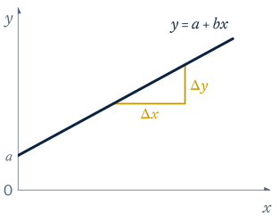
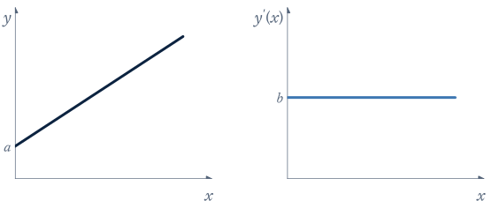
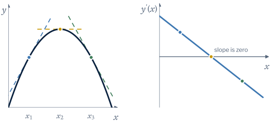
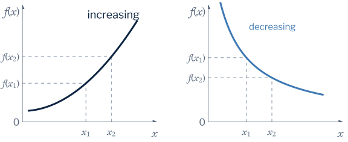

## {.course-title .center background-color="#0C2340" background-image="../theme/title-curves.svg" background-size="cover"}

[Lesson 2]{.lesson-no}

<h1 class="lesson-title">Math Review</h1>

::: {.lesson-meta}
FIN 30210 Managerial Economics 
Jason R. Reed, PhD, University of Notre Dame
:::

## Functions

$$
y = f(x)
$$

- $y$ is a function of $x$: $y$ in terms of $x$
- $y$ is the **dependent variable** and $x$ is the **independent variable**
- A linear function can be written in the general form $y = f(x) = a + bx$

## Linear functions

::: {.split}
{fig-alt="A straight line rising from intercept a on the vertical axis, with a rise-over-run triangle marking delta y over delta x."}

::: {.col}
- The intercept is the constant $a$
- The slope is the constant $b$
- We'll generally only concern ourselves with the positive quadrant

$$
\text{Slope} = \frac{\Delta y}{\Delta x} = \frac{y_2 - y_1}{x_2 - x_1} = \frac{f(x_2) - f(x_1)}{x_2 - x_1}
$$
:::
:::

::: notes
The slope formula is the basis for introducing calculus.
:::

## Rules of exponents

[The hardest part of this class is the algebra, not the calculus.]{.lede}

::: {.eq-grid .three}
$$x^m \cdot x^n = x^{m+n}$$

$$(x^m)^n = x^{mn}$$

$$(xy)^m = x^m y^m$$

$$x^0 = 1$$

$$x^{-m} = \frac{1}{x^m}$$

$$x^{\frac{1}{n}} = \sqrt[n]{x}$$
:::

## Solving systems of equations

Most of our optimization analysis will require solving for more than one independent variable. Generally we'll have two equations and two unknowns, but we could have more.

To solve a linear system of equations, eliminate a variable and reduce the number of equations:

- Substitution
- Equation manipulation
- Linear algebra: elementary row operations

# Calculus and the derivative {.section-break background-color="#0C2340" background-image="../theme/section-grid.svg" background-size="cover"}

## So why use the derivative?

- Derivatives measure the change in an outcome from a change in only one independent variable
  - Instead of a large discrete change, say from 1 to 2, we can observe a tiny one, say from 1 to 1.0000000001
  - The derivative measures infinitesimally small (continuous) changes

::: {.equation}
$$
f'(x) = \lim_{h \to 0} \frac{f(x+h) - f(x)}{h}
$$
:::

## The derivative is a slope

For our purposes, you can begin to equate the derivative with the slope.

::: {.figure-wide}
{fig-alt="Left: a line with intercept a. Right: its derivative, a flat line at height b."}
:::

## When the function isn't linear, the slope is a function too

::: {.figure-wide}
{fig-alt="Left: a hill-shaped curve with tangent lines at x1, x2, and x3; the tangent at x2 is flat. Right: the derivative, a downward-sloping line that crosses zero at x2."}
:::

Measure the slope of the tangent line at each point. At $x_2$ the tangent is flat, so the derivative is zero.

# Derivative rules {.section-break background-color="#0C2340" background-image="../theme/section-grid.svg" background-size="cover"}

## Power, sum, and difference rules

Given $y = f(x) = ax^b$,

::: {.equation}
$$
\frac{dy}{dx} = f'(x) = bax^{b-1}
$$
:::

Given $u = g(x)$, $v = h(x)$, and $y = f(x) = u \pm v = g(x) \pm h(x)$,

::: {.equation}
$$
\frac{dy}{dx} = f'(x) = \frac{du}{dx} \pm \frac{dv}{dx}
$$
:::

## Product and quotient rules

Given $u = g(x)$, $v = h(x)$, and $y = f(x) = uv = g(x) \cdot h(x)$,

$$
\frac{dy}{dx} = f'(x) = v\left(\frac{du}{dx}\right) + u\left(\frac{dv}{dx}\right) = u\,h'(x) + v\,g'(x)
$$

Given $y = f(x) = \dfrac{u}{v} = \dfrac{g(x)}{h(x)}$,

$$
\frac{dy}{dx} = f'(x) = \frac{v\left(\frac{du}{dx}\right) - u\left(\frac{dv}{dx}\right)}{v^2} = \frac{h(x)\,g'(x) - g(x)\,h'(x)}{h(x)^2}
$$

## Chain rule

Given $y = f(u)$ and $u = g(x)$, so that $y = f[g(x)]$,

::: {.equation}
$$
\frac{dy}{dx} = \left(\frac{dy}{du}\right)\left(\frac{du}{dx}\right) = \left[\frac{df(u)}{du}\right]\left[\frac{dg(x)}{dx}\right] = f'(u) \cdot g'(x)
$$
:::

# Partial derivatives {.section-break background-color="#0C2340" background-image="../theme/section-grid.svg" background-size="cover"}

## Partial derivatives

$$
z = f(x, y)
$$

Here there are several independent variables. When we take the derivative with respect to one of them, we assume the others aren't changing.

- We treat everything other than the variable we're changing (coefficients, parameters, other variables) as a constant
- All of the single-variable derivative rules apply

The notational change is $\dfrac{\partial f(x, y)}{\partial x}$ in place of $\dfrac{dy}{dx}$.

## Partial derivatives: an example

$$
z = 3x^2 + \tfrac{1}{2}y^{-4} + 15xy + 100
$$

::: {.eq-grid}
::: {.fragment}
$$\frac{\partial z}{\partial x} = 6x + 15y$$
:::

::: {.fragment}
$$\frac{\partial z}{\partial y} = -2y^{-5} + 15x$$
:::
:::

## Second partial and cross-partial derivatives

Continuing the example, differentiate each first partial again.

::: {.eq-grid}
$$\frac{\partial^2 z}{\partial x^2} = 6$$

$$\frac{\partial^2 z}{\partial y^2} = 10y^{-6}$$

::: {.fragment}
$$\frac{\partial^2 z}{\partial x\,\partial y} = 15$$
:::

::: {.fragment}
$$\frac{\partial^2 z}{\partial y\,\partial x} = 15$$
:::
:::

::: {.fragment .small}
For the cross-partial, differentiate $\partial z / \partial x$ with respect to $y$, or $\partial z / \partial y$ with respect to $x$. Either order gives the same answer.
:::

# Optimization {.section-break background-color="#0C2340" background-image="../theme/section-grid.svg" background-size="cover"}

## Optimization in three steps

1. Define the goals and objectives of the firm
2. Identify the firm's constraints
3. Analyze and evaluate all the alternatives available to the decision maker

For profit or utility maximization and cost minimization, this means taking the first derivative of the function, subject to any relevant constraints, and setting the result equal to zero.

## First-derivative test for a relative extremum

If the first derivative of $f(x)$ at $x = x_0$ is $f'(x_0) = 0$, then the value of the function at $x_0$ is

::: {.terms}
::: {.t}
A maximum
:::

::: {.d}
if the derivative changes sign from positive to negative, moving from the immediate left of $x_0$ to its immediate right
:::

::: {.t}
A minimum
:::

::: {.d}
if the derivative changes sign from negative to positive, moving from the immediate left of $x_0$ to its immediate right
:::

::: {.t}
Neither
:::

::: {.d}
if the derivative has the same sign on both the immediate left and right of $x_0$
:::
:::

## Second-derivative test for a relative extremum

If the first derivative of $f(x)$ at $x = x_0$ is $f'(x_0) = 0$, then the value of the function at $x_0$ is

::: {.terms}
::: {.t}
A relative maximum
:::

::: {.d}
if the second derivative at $x_0$ is negative: $f''(x_0) < 0$
:::

::: {.t}
A relative minimum
:::

::: {.d}
if the second derivative at $x_0$ is positive: $f''(x_0) > 0$
:::
:::

## Finding relative extrema

::: {.problem}
[Example]{.problem-label}
Find the relative extrema of the function

$$
y = f(x) = x^3 - 12x^2 + 36x + 8
$$
:::

# Constrained optimization {.section-break background-color="#0C2340" background-image="../theme/section-grid.svg" background-size="cover"}

## Constrained optimization

After taking the first derivative, we set the result equal to zero and solve for the relative extremum. Usually, though, we'll face a maximization or minimization problem with constraints:

::: {.equation}
$$
\max(\min)\; y = f(x_1, x_2) \quad \text{subject to} \quad k = g(x_1, x_2)
$$
:::

There are two methods for solving it:

- The substitution method
- The Lagrange multiplier method

## The substitution method

**Substitution** plugs the constraint into the objective function, so the optimization is performed on a (slightly) new objective function.

::: {.eq-grid}
::: {.col}
[Original problem]{.small}

$$
\begin{aligned}
&\min_{x,y}\; f(x, y) = 30x^2 + 6y^2 - xy \\
&\text{s.t.}\;\; x = 20 - y
\end{aligned}
$$
:::

::: {.col .fragment}
[After substituting for $x$]{.small}

$$
\min_{y}\; f(y) = 30(20 - y)^2 + 6y^2 - (20 - y)y
$$
:::
:::

## Substitution: solving the example

::: {.eq-steps}
$$
f(y) = 30(20 - y)^2 + 6y^2 - (20 - y)y = 12{,}000 - 1{,}220y + 37y^2
$$

::: {.fragment}
$$
\frac{df(y)}{dy} = -1{,}220 + 74y = 0 \quad\Rightarrow\quad y^* = \frac{1{,}220}{74} \approx 16.49, \quad x^* = 20 - y^* \approx 3.51
$$
:::

::: {.fragment}
$$
\frac{d^2 f(y)}{dy^2} = 74 > 0
$$
:::
:::

::: {.takeaway .fragment}
The second derivative is positive, so this extremum is a minimum.
:::

## The Lagrange multiplier method

The **Lagrange multiplier method** creates a new objective function with a new parameter, $\lambda$, called the **shadow price**.

$$
\begin{aligned}
&\min_{x,y}\; f(x, y) = 30x^2 + 6y^2 - xy \quad \text{s.t.}\;\; 20 = x + y \\[0.4em]
&\mathcal{L}(x, y, \lambda) = f(x, y) + \lambda\, g(x, y) = 30x^2 + 6y^2 - xy + \lambda(20 - y - x)
\end{aligned}
$$

To use this method, you must **set the constraint equal to zero**. It doesn't matter whether you move everything to the right or the left.

## Interpreting λ, the shadow price

Technically,

$$
\lambda^*(k) = \frac{\partial \mathcal{L}}{\partial k}, \quad \text{where } k \text{ is the constraint value (here } 20 = x + y\text{, so } k = 20\text{)}
$$

- It's the **marginal change** in the optimal value of the objective function from a change in the constraint
- Intuitively, Lagrange multipliers are the prices optimizers would pay to loosen their constraints

::: {.prompt}
What happens to the value of the objective function if $k$ changes from 20 to 21?
:::

## First-order conditions

- Treat $\lambda$ as an additional choice variable and take the partial derivative with respect to each input, and with respect to $\lambda$
- That gives as many first-order conditions as there are inputs, plus one for $\lambda$

::: {.definition}
[First-order conditions]{.term}
A set of simultaneous equations that we solve for the values of our inputs and $\lambda$.
:::

## Finding an extremum two ways

::: {.problem}
[Problem 2.1]{.problem-label}
Find the extremum (max or min) using the substitution method and the Lagrange multiplier method.

$$
U = x_1 x_2 + 2x_1 \quad \text{s.t.} \quad 4x_1 + 2x_2 = 60
$$
:::

## Problem 2.1: first-order conditions

$$
\mathcal{L}(x_1, x_2, \lambda) = x_1 x_2 + 2x_1 + \lambda(60 - 4x_1 - 2x_2)
$$

::: {.eq-steps}
::: {.fragment}
$$
\frac{\partial \mathcal{L}}{\partial x_1} = x_2 + 2 - 4\lambda = 0
$$
:::

::: {.fragment}
$$
\frac{\partial \mathcal{L}}{\partial x_2} = x_1 - 2\lambda = 0
$$
:::

::: {.fragment}
$$
\frac{\partial \mathcal{L}}{\partial \lambda} = 60 - 4x_1 - 2x_2 = 0
$$
:::
:::

## Problem 2.1: solution

::: {.cols-2}
::: {.col}
[Solve each condition for λ]{.h}

$$
\begin{aligned}
&\tfrac{1}{4}x_2 + \tfrac{1}{2} = \lambda \\
&\tfrac{1}{2}x_1 = \lambda \\
&\tfrac{1}{2}x_1 = \tfrac{1}{4}x_2 + \tfrac{1}{2} \;\Rightarrow\; x_2 = 2x_1 - 2
\end{aligned}
$$
:::

::: {.col .fragment}
[Substitute into the constraint]{.h}

$$
\begin{aligned}
&60 - 4x_1 - 2(2x_1 - 2) = 0 \\
&64 = 8x_1 \;\Rightarrow\; x_1^* = 8 \\
&x_2^* = 2(8) - 2 = 14 \\
&\lambda^* = \tfrac{1}{2}(8) = 4
\end{aligned}
$$
:::
:::

## Practice: Lagrange multipliers

::: {.problem}
[Problem 2.2]{.problem-label}
Use the Lagrange multiplier approach to find the constrained extremum values.

$$
Z = x(y + 4) \quad \text{s.t.} \quad x + y = 8
$$
:::

## Resources

::: {.resources}
C. Featherstone, "Lagrange multipliers as shadow prices," section notes, 2007.

T. J. Webster, *Managerial Economics: Theory and Practice*, Academic Press, 2003.
:::

# Appendix {.section-break background-color="#0C2340" background-image="../theme/section-grid.svg" background-size="cover"}

## Monotonic functions

::: {.figure-wide .short}
{fig-alt="Left: an increasing curve, with f of x2 above f of x1. Right: a decreasing curve, with f of x2 below f of x1."}
:::

::: {.cols-2}
::: {.col}
[Monotonically increasing]{.h}
If $x_2 > x_1$, then $f(x_2) > f(x_1)$
:::

::: {.col}
[Monotonically decreasing]{.h}
If $x_2 > x_1$, then $f(x_2) < f(x_1)$
:::
:::

::: notes
Functions can be thought of as mappings, or transformations.
:::

## Logarithmic, exponential, and inverse functions

::: {.eq-steps}
Given $y = \log_e x$: $\quad \dfrac{dy}{dx} = \dfrac{d(\log_e x)}{dx} = \dfrac{1}{x}$

Given $y = e^x$: $\quad \dfrac{dy}{dx} = \dfrac{d(e^x)}{dx} = e^x$

Given $y = f(x)$ and its inverse $g(y) = f^{-1}(y) = x$: $\quad g'(y) = \dfrac{dx}{dy} = \dfrac{1}{dy/dx} = \dfrac{1}{f'(x)}$
:::

## Implicit differentiation

Some functions don't have explicit input components, and the dependent variable may also be functionally related to one or more of the right-hand-side variables. For example, national income:

::: {.equation}
$$
Y = C + I + G + (X - M)
$$
:::

Taking the **total derivative** gives a differential equation that helps define the functions further:

$$
dY = dC + dI + dG + d(X - M)
$$

## Implicit differentiation: the multiplier

Let consumption depend on income, $C = C(Y)$, so that

$$
dY = \left(\frac{dC}{dY}\right) dY + dI + dG + d(X - M)
$$

To find $dY/dI$, assume $I$ has no relationship to $G$ or to $X - M$, but does change $Y$: $\;dG = d(X - M) = 0$.

::: {.eq-grid}
::: {.fragment}
$$
dY = \left(\frac{dC}{dY}\right) dY + dI
$$
:::

::: {.fragment}
$$
\frac{dY}{dI} = \frac{1}{1 - \left(\frac{dC}{dY}\right)}
$$
:::
:::

## {.next-up .center background-color="#0C2340" background-image="../theme/section-grid.svg" background-size="cover"}

[Up next: Lesson 3]{.lesson-no}

<h1>The Essentials of Supply and Demand</h1>

::: {.next-links}
[Open Lesson 3](lesson-03.html) [All lessons](../index.html)
:::
