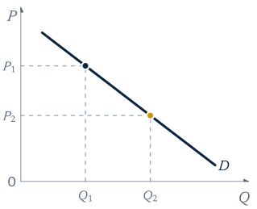
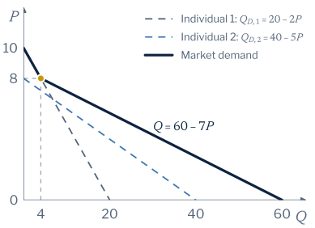
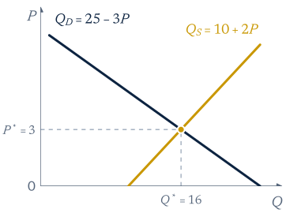
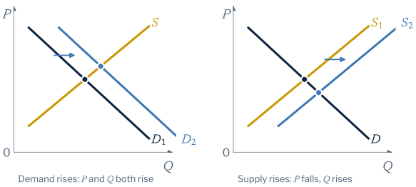
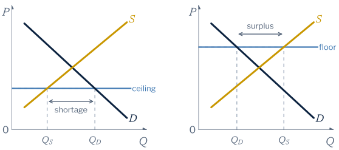

## {.course-title .center background-color="#0C2340" background-image="../theme/title-curves.svg" background-size="cover"}

[Lesson 3]{.lesson-no}

<h1 class="lesson-title">The Essentials of Supply and Demand</h1>

::: {.lesson-meta}
FIN 30210 Managerial Economics 
Jason R. Reed, PhD, University of Notre Dame
:::

# Demand {.section-break background-color="#0C2340" background-image="../theme/section-grid.svg" background-size="cover"}

## The law of demand

- To maximize profit, firms need to know the demand for their good or service
  - We'll learn how to estimate demand using regression techniques

::: {.definition}
[The law of demand]{.term}
The quantity demanded of a good or service is inversely related to its selling price, *ceteris paribus*.
:::

$$
Q_d = f(P), \quad \frac{dQ_d}{dP} < 0
$$

- Quantity demanded is a function of price
- Price won't be the only input, but it's the only one we use when graphing

::: notes
The relationship between the demand function and a firm's production decisions is complicated. In general, the demand function is elusive and most often loosely defined for the firm. One driving force behind the difficulty is that prices don't often change enough to reveal an accurate quantity demanded. As economists, one role we play is to estimate the relationship quantity demanded has with price, among other determinants.

Simply stated, the law of demand identifies the inverse relationship between prices and quantities, all else equal.
:::

## Why demand slopes down

::: {.split .text-left}
::: {.col}
The inverse relationship between price and quantity is generally due to

- The law of diminishing marginal utility
- Income and substitution effects

We graph demand with $P$ on the vertical axis and $Q$ on the horizontal axis.
:::

{fig-alt="A downward-sloping demand curve: when price falls from P1 to P2, quantity demanded rises from Q1 to Q2."}
:::

## Utility and diminishing marginal utility

::: {.terms}
::: {.t}
Utility
:::

::: {.d}
A measure of general happiness from consuming a good or service. It isn't a measure of usefulness but of preference, and preferences are idiosyncratic.
:::

::: {.t}
Diminishing marginal utility
:::

::: {.d}
As consumption of a good or service increases, the marginal utility from each additional unit decreases. To make up for the drop in marginal utility, a consumer needs lower prices to keep consuming.
:::
:::

## Income and substitution effects

::: {.cols-2}
::: {.col}
[Income effect]{.h}
As a product's price falls (rises), a consumer's purchasing power rises (falls), so they can generally buy more.

[**Normal goods:** as purchasing power rises, quantity demanded rises. **Inferior goods:** as purchasing power rises, quantity demanded falls.]{.note}
:::

::: {.col}
[Substitution effect]{.h}
Reflects changes in consumers' opportunity costs. As a product's price falls, consumers substitute it for similar goods that are now relatively more expensive.
:::
:::

In most cases the two effects reinforce each other: a lower price generally brings a positive income effect *and* a positive substitution effect.

::: notes
Even for inferior goods, where the income effect is negative, the ordinary demand curve slopes down, because the substitution effect, which is always positive when price drops, outweighs the negative income effect.
:::

## Market demand is the sum of individual demands

For a particular good or service, the market demand curve is built by summing individual consumers' quantities demanded at each market price.

::: {.eq-grid}
$$
\begin{aligned}
Q_{d,1} &= a_1 + b_1 P \\
Q_{d,2} &= a_2 + b_2 P \\
Q_{d,3} &= a_3 + b_3 P
\end{aligned}
$$

::: {.fragment}
$$
Q_{d,1} + Q_{d,2} + Q_{d,3} = (a_1 + a_2 + a_3) + (b_1 + b_2 + b_3)P
$$
:::
:::

::: {.fragment}
$$
Q_{D,M} = \sum_{i=1}^{n} Q_{d,i} = \sum_{i=1}^{n} a_i + \sum_{i=1}^{n} b_i P
$$
:::

## Market demand with identical consumers

::: {.problem}
[Example 3.1]{.problem-label}
The total market demand for a product comes from three individuals with identical demand equations. What is the market demand equation?

$$
Q_{d,1} = Q_{d,2} = Q_{d,3} = 50 - 25P
$$
:::

::: {.solution-step .fragment}
[Solution]{.label}

::: {.v}
$Q_D = 3(50 - 25P) = 150 - 75P$
:::
:::

## Market demand with different consumers

::: {.problem}
[Example 3.2]{.problem-label}
The total market demand for a product comes from two individuals with the following demand equations. What is the market demand equation?

$$
Q_{d,1} = 20 - 2P \qquad Q_{d,2} = 40 - 5P
$$
:::

::: {.solution-step .fragment}
[Choke prices]{.label}

::: {.v}
Solving each for price: $P = 10 - 0.5Q_{d,1}$ and $P = 8 - 0.2Q_{d,2}$. Individual 2 buys nothing above \$8.
:::
:::

::: {.solution-step .fragment}
[Market demand]{.label}

::: {.v}
For $P > \$8$, only individual 1 buys: $Q = 20 - 2P$. For $P \le \$8$, both buy: $Q = (20 - 2P) + (40 - 5P) = 60 - 7P$.
:::
:::

## The market demand curve has a kink

::: {.figure-wide}
{fig-alt="Two dashed individual demand curves and the solid market demand curve. The market curve follows individual 1 from a price of 10 down to 8, then kinks at a quantity of 4 and follows Q = 60 minus 7P to a quantity of 60."}
:::

Above \$8 the market curve is individual 1's demand. At \$8 individual 2 enters, and the curve bends to $Q = 60 - 7P$.

## Determinants of demand

::: {.cols-3}
::: {.col}
[Income]{.h}
Normal and inferior goods. Which is which is subjective.
:::

::: {.col}
[Tastes or preferences]{.h}
For example, recent trends in health.
:::

::: {.col}
[Prices of related goods]{.h}
Substitutes and complements.
:::

::: {.col}
[Price expectations]{.h}
If we believe prices will be lower in the future, demand will be lower today.
:::

::: {.col}
[Consumers in the market]{.h}
More buyers means more demand at every price.
:::
:::

The function for market demand resembles

$$
Q_D = f(P, I, T, P_s, P_c, P^e, N)
$$

::: notes
Make sure to draw the graphs here.
:::

## Each determinant moves demand in a known direction

From the demand function, the partial derivative with respect to each determinant is the marginal change in quantity demanded. Essentially, we're observing the coefficients on the determinants in the demand curve.

::: {.eq-grid .four}
$$\frac{\partial Q_D}{\partial P} < 0$$

$$\frac{\partial Q_D}{\partial I} > 0$$

$$\frac{\partial Q_D}{\partial T} > 0$$

$$\frac{\partial Q_D}{\partial P_s} > 0$$

$$\frac{\partial Q_D}{\partial P_c} < 0$$

$$\frac{\partial Q_D}{\partial P^e} > 0$$

$$\frac{\partial Q_D}{\partial N} > 0$$
:::

[$\partial Q_D / \partial I > 0$ holds for normal goods; for inferior goods it's negative.]{.small}

# Estimating demand {.section-break background-color="#0C2340" background-image="../theme/section-grid.svg" background-size="cover"}

## A linear demand equation

The most common form for estimating market demand is a linear equation:

$$
Q_D = b_0 + b_1 P + b_2 I + b_3 P_s + b_4 P_c + b_5 P^e + b_6 N
$$

- To find the effect each term has on market demand, use the partial derivative to find the marginal effect
- To keep the analysis simple, assume only price and quantity can change, and fold all the other variables into a known constant:

$$
Q_D = \xi + b_1 P, \quad \text{where } \xi = b_0 + b_2 I + b_3 P_s + b_4 P_c + b_5 P^e + b_6 N
$$

## Estimating demand with regression

Using ordinary least squares (OLS) regression, we can estimate a demand function.

- In Excel, use the Data Analysis toolpak
- We need data on the independent variables we believe influence demand: price, advertising, income, and so on
- We need data on the dependent variable, quantity

## Interpreting an estimated demand equation

::: {.problem}
[Problem 3.3]{.problem-label}
Monthly demand for a popular brand of fruit drink is $Q_x = 10 - 5P_x + 0.001I + 10P_y$, where $Q_x$ is gallons consumed per family per month, $P_x = \$2.00$ is the drink's price per gallon, $I = \$20{,}000$ is median annual family income, and $P_y = \$2.50$ is the price per gallon of a competing brand.

1. Interpret the parameter estimates.
2. At these values, how many gallons does a family consume each month?
3. Rewrite the demand equation in the form $Q_D = \xi + b_1 P$.
4. If median family income rises to \$30,000, how does your answer to part 2 change?
:::

## Problem 3.3: solution

::: {.solution-step .fragment}
[Parameters]{.label}

::: {.v}
A \$1 increase in the drink's price cuts monthly consumption by 5 gallons. A \$1,000 increase in income adds 1 gallon. A \$1 increase in the competitor's price adds 10 gallons, so the two brands are substitutes.
:::
:::

::: {.solution-step .fragment}
[Consumption]{.label}

::: {.v}
$Q_x = 10 - 5(2.00) + 0.001(20{,}000) + 10(2.50) = 45$ gallons
:::
:::

::: {.solution-step .fragment}
[Reduced form]{.label}

::: {.v}
$Q_x = 55 - 5P_x$
:::
:::

::: {.solution-step .fragment}
[Higher income]{.label}

::: {.v}
$Q_x = 10 - 5(2.00) + 0.001(30{,}000) + 10(2.50) = 55$ gallons
:::
:::

# Supply {.section-break background-color="#0C2340" background-image="../theme/section-grid.svg" background-size="cover"}

## The law of supply

::: {.definition}
[The law of supply]{.term}
The quantity supplied of a good or service is directly related to its selling price, *ceteris paribus*.
:::

$$
Q_s = g(P), \quad \frac{dQ_s}{dP} > 0
$$

The result is a monotonically increasing relationship. Intuitively, as price rises, profits rise too, so firms supply more goods and services.

## Profit, revenue, and cost

Profit is defined as

$$
\pi(Q) = TR(Q) - TC(Q)
$$

- Total revenue is a function of quantity: $TR(Q) = PQ$
- Total cost is a function of the labor and capital inputs: $TC(Q) = h(Q) = h[k(L, K)] = \ell(L, K)$

We can also write total cost as fixed plus variable cost:

$$
TC = TFC + TVC = TFC + w \cdot L + r \cdot K
$$

where total fixed cost is a constant, and total variable cost is a linear combination of the input prices: $w$ is the wage rate for labor and $r$ is the rental price of capital.

## Determinants of market supply

::: {.terms}
::: {.t}
Input prices ($w$, $r$)
:::

::: {.d}
As input prices rise, total costs rise and firms produce less: supply shifts left.
:::

::: {.t}
Technology ($e$)
:::

::: {.d}
Better methods of management or production raise productive efficiency. Supply increases because firms can produce more with the same inputs.
:::

::: {.t}
Taxes and subsidies ($R$)
:::

::: {.d}
Higher taxes raise total costs and reduce profits. Higher subsidies lower total costs and raise profits.
:::
:::

## More determinants of market supply

::: {.terms}
::: {.t}
Related goods ($P_s$, $P_c$)
:::

::: {.d}
**Substitutes in production** can be made with the same fixed facilities, such as corn or wheat. **Complements in production** are made together, such as beef and leather.
:::

::: {.t}
Price expectations ($P^e$)
:::

::: {.d}
If firms expect higher prices in the future, they'll hold back output today to sell tomorrow.
:::

::: {.t}
Number of firms ($F$)
:::

::: {.d}
As firms enter the industry, total supply increases and the market supply curve shifts right.
:::
:::

Market supply collects these determinants:

$$
Q_S = f(P, w, r, e, R, P_s, P_c, P^e, F)
$$

::: notes
Write down the partial derivatives and their directions here.
:::

# The market mechanism {.section-break background-color="#0C2340" background-image="../theme/section-grid.svg" background-size="cover"}

## Prices ration goods

- Price is the mechanism that brings quantity demanded in line with quantity supplied. We say prices are a rationing mechanism.
- The equilibrium condition requires $Q_D = Q_S = Q^*$
- With excess demand, prices are bid up until $Q^*$ is reached; with excess supply, prices are bid down until $Q^*$ is reached

## Finding the equilibrium

::: {.split .text-left}
::: {.col}
::: {.problem}
[Problem 3.4]{.problem-label}
Market demand and supply for a product are $Q_D = 25 - 3P$ and $Q_S = 10 + 2P$. What are the equilibrium price and quantity?
:::

::: {.eq-steps .fragment}
$25 - 3P = 10 + 2P$

$P^* = 3$

$Q^* = 25 - 3(3) = 10 + 2(3) = 16$
:::
:::

::: {.fragment}
{fig-alt="Demand Q = 25 minus 3P and supply Q = 10 plus 2P crossing at a price of 3 and a quantity of 16."}
:::
:::

## Changes in supply and demand

::: {.figure-wide .short}
{fig-alt="Left: demand shifts right along a fixed supply curve, raising price and quantity. Right: supply shifts right along a fixed demand curve, lowering price and raising quantity."}
:::

- A single shift in demand or supply changes the equilibrium unambiguously
- Simultaneous shifts can make the change in price or quantity ambiguous

::: {.prompt}
Demand rises while supply falls. What happens to price? To quantity?
:::

::: notes
Work through all four simultaneous cases: demand up and supply down, both up, both down, demand down and supply up.
:::

## Shortages, surpluses, and price controls

::: {.figure-wide .short}
{fig-alt="Left: a price ceiling below equilibrium creates a shortage, quantity demanded exceeding quantity supplied. Right: a price floor above equilibrium creates a surplus."}
:::

::: {.cols-2}
::: {.col}
[Price ceiling, shortage]{.h}
A legal maximum price. Quantity supplied falls short of quantity demanded, so goods get rationed by queuing, waiting lists (rent control), bribes, or favored customers.
:::

::: {.col}
[Price floor, surplus]{.h}
A legal minimum price, such as the minimum wage. Quantity demanded falls short of quantity supplied.
:::
:::

## {.next-up .center background-color="#0C2340" background-image="../theme/section-grid.svg" background-size="cover"}

[Up next: Lesson 4]{.lesson-no}

<h1>Elasticity</h1>

::: {.next-links}
[Open Lesson 4](lesson-04.html) [All lessons](../index.html)
:::
