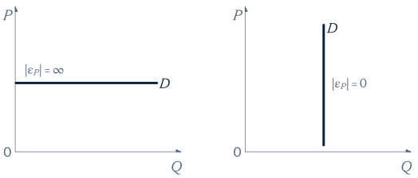
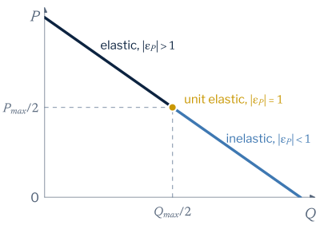
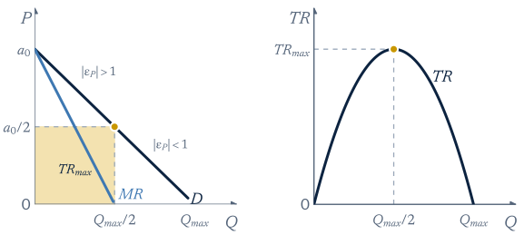

## {.course-title .center background-color="#0C2340" background-image="../theme/title-curves.svg" background-size="cover"}

[Lesson 4]{.lesson-no}

<h1 class="lesson-title">Elasticity</h1>

::: {.lesson-meta}
FIN 30210 Managerial Economics 
Jason R. Reed, PhD, University of Notre Dame
:::

# Price elasticity of demand {.section-break background-color="#0C2340" background-image="../theme/section-grid.svg" background-size="cover"}

## Why not just use the slope?

Elasticity measures how responsive quantity demanded is to changes in price. So why not use the slope, $b_1 = \Delta Q_D / \Delta P$?

::: {.fragment}
- **Slope ignores the price level.** A \$1,000 rebate on a \$10,000 car is much more attractive than the same rebate on a \$100,000 car.
- **Slope depends on the units of measurement.**
:::

## Slope changes with the units

::: {.cols-2}
::: {.col}
[Slope measured in dollars]{.h}

$$
b_1 = \frac{\Delta Q_D}{\Delta P} = \frac{22 - 12}{2.10 - 2.30} = \frac{10}{-0.20} = -50
$$
:::

::: {.col .fragment}
[Slope measured in cents]{.h}

$$
b_1 = \frac{\Delta Q_D}{\Delta P} = \frac{22 - 12}{210 - 230} = \frac{10}{-20} = -0.50
$$
:::
:::

::: {.takeaway .fragment}
Same demand, same price change: the slope differs by a factor of 100.
:::

## Price elasticity of demand

::: {.definition}
[Price elasticity of demand]{.term}
The percentage change in the quantity demanded of a good or service, given a percentage change in its price.
:::

::: {.equation}
$$
E_P = \left| \frac{\%\,\Delta Q_D}{\%\,\Delta P} \right|
$$
:::

One issue: starting points matter, sometimes a lot. *We observe different elasticities depending on whether price increases or decreases.*

::: notes
We take the absolute value because demand is always negatively sloped.
:::

## Using an elasticity

::: {.problem}
[Problem 4.1]{.problem-label}
The price elasticity of demand for a product is −2. If its price falls by 5%, by what percentage does quantity demanded change?
:::

::: {.solution-step .fragment}
[Solution]{.label}

::: {.v}
$-2 = \dfrac{\%\,\Delta Q_D}{-5\%} \;\Rightarrow\; \%\,\Delta Q_D = +10\%$
:::
:::

## The midpoint formula

The **midpoint formula** helps by averaging the starting and ending prices and quantities:

::: {.equation}
$$
E_P = \frac{\dfrac{Q_2 - Q_1}{(Q_2 + Q_1)/2}}{\dfrac{P_2 - P_1}{(P_2 + P_1)/2}}
$$
:::

One issue arises when nonlinear demand functions are introduced.

## Point price elasticity

Unlike slope, the point price elasticity takes the first derivative of the demand curve and evaluates it at a given point on the curve.

::: {.equation}
$$
E_P = \left| \left(\frac{dQ_D}{dP}\right) \cdot \left(\frac{P}{Q_D}\right) \right|
$$
:::

::: {.problem .fragment}
[Example]{.problem-label}
The demand equation for a product is $Q_D = 50 - 2.25P$. Calculate the point price elasticity of demand at $P = 2$.
:::

## Point price elasticity: solution

::: {.eq-steps}
$$
E_P = \left| \left(\frac{dQ_D}{dP}\right)\left(\frac{P}{Q_D}\right) \right|
$$

::: {.fragment}
$$
= \left| -2.25 \left(\frac{P}{50 - 2.25P}\right) \right| = \left| -2.25 \left(\frac{2}{50 - 2.25(2)}\right) \right|
$$
:::

::: {.fragment}
$$
= \left| -2.25 \left(\frac{2}{45.5}\right) \right| = |-0.099| = 0.099
$$
:::
:::

::: {.takeaway .fragment}
At \$2, demand is highly inelastic.
:::

## Elastic, inelastic, and unit elastic

::: {.terms}
::: {.t}
Elastic
:::

::: {.d}
$|\varepsilon_P| > 1$. The percentage change in quantity demanded is *greater* than the percentage change in price.
:::

::: {.t}
Inelastic
:::

::: {.d}
$|\varepsilon_P| < 1$. The percentage change in quantity demanded is *less* than the percentage change in price.
:::

::: {.t}
Unit elastic
:::

::: {.d}
$|\varepsilon_P| = 1$. The percentage change in quantity demanded *equals* the percentage change in price.
:::
:::

## The extremes

::: {.figure-wide .short}
{fig-alt="Left: a horizontal demand curve, perfectly elastic. Right: a vertical demand curve, perfectly inelastic."}
:::

::: {.cols-2}
::: {.col}
[Perfectly elastic]{.h}
$|\varepsilon_P| = \infty$. A horizontal line: price and quantity have no relationship, and the slope is zero.
:::

::: {.col}
[Perfectly inelastic]{.h}
$|\varepsilon_P| = 0$. A vertical line: price and quantity have an undefined slope.
:::
:::

## Elasticity changes along a linear demand curve

::: {.figure-wide}
{fig-alt="A straight demand curve. The upper half is elastic, the midpoint is unit elastic, and the lower half is inelastic."}
:::

A straight demand curve has a constant slope, but its elasticity runs from elastic at high prices to inelastic at low prices.

::: notes
The demand curve covers a whole range of elasticities.
:::

## Determinants of elasticity

::: {.cols-4}
::: {.col}
[Substitutability]{.h}
More substitutes, more elastic demand.
:::

::: {.col}
[Share of income]{.h}
A higher share of income, more elastic demand.
:::

::: {.col}
[Luxuries vs. necessities]{.h}
Demand for luxuries is more elastic.
:::

::: {.col}
[Time]{.h}
More time available, more elastic demand.
:::
:::

::: notes
Substitutability: with more substitutes, consumers have more alternatives, so a price change brings a bigger percentage change in quantity demanded. The broader the definition of the market, the more elastic the demand; the narrower the definition, the more inelastic.

Share of income: the bigger the share of income needed to buy the good, the more elastic the demand. Consumers are more sensitive because a price change can mean thousands of dollars.

Luxuries: consumers can go without them, so they change how much they buy by a lot even for a small price change.

Time: it takes time to change what you buy, so more time means more elastic demand. Someone doing their Christmas shopping on Christmas Eve has very inelastic demand, because they don't have time to look for alternatives.
:::

# Elasticity and revenue {.section-break background-color="#0C2340" background-image="../theme/section-grid.svg" background-size="cover"}

## Elasticity and revenue

Firms (and governments) understand the connection between elasticity and revenue:

- Pharmaceutical companies charge high prices for drugs and health care
- Higher taxes are often imposed on goods like gasoline, alcohol, and nicotine

::: {.cols-3}
::: {.col}
[Elastic goods]{.h}
*Lower* prices increase revenue.
:::

::: {.col}
[Inelastic goods]{.h}
*Higher* prices increase revenue.
:::

::: {.col}
[Unit-elastic goods]{.h}
Revenue is already at its maximum.
:::
:::

## Revenue peaks where demand is unit elastic

::: {.figure-wide}
{fig-alt="Left: linear demand and a marginal revenue curve twice as steep; the total revenue rectangle is largest at the midpoint, where MR equals zero. Right: total revenue rises then falls, peaking at half the maximum quantity."}
:::

Marginal revenue hits zero at the midpoint of the demand curve, where demand is unit elastic and total revenue is at its maximum.

::: notes
Draw out the examples here.
:::

## How price changes move total revenue

| $\lvert\varepsilon_P\rvert$ | $\Delta P$ | $\Delta Q$ | $\Delta TR$ |
|:---:|:---:|:---:|:---:|
| $> 1$ | − | + | + |
| $> 1$ | + | − | − |
| $< 1$ | − | + | − |
| $< 1$ | + | − | + |

::: {.takeaway}
When demand is elastic, price and revenue move in opposite directions. When it's inelastic, they move together.
:::

## Deriving marginal revenue

Let $Q = b_0 - b_1 P$ be a linear demand curve. Solve for price in terms of quantity:

$$
P = a_0 - a_1 Q, \quad \text{where } a_0 = \frac{b_0}{b_1},\; a_1 = \frac{1}{b_1}
$$

::: {.fragment}
$$
TR = P \cdot Q = (a_0 - a_1 Q)Q = a_0 Q - a_1 Q^2
$$
:::

::: {.fragment}
$$
\frac{dTR}{dQ} = MR = a_0 - 2a_1 Q
$$
:::

::: {.fragment}
Set $MR = 0$ and solve for $Q$ to find the revenue-maximizing quantity: $Q = \dfrac{a_0}{2a_1} = \dfrac{b_0}{2}$.
:::

## Elasticity and total revenue

::: {.problem}
[Problem 4.8]{.problem-label}
For the demand equation $Q = 50 - 2.5P$, calculate the point price elasticity of demand and total revenue at $P = 0, 5, 10, 15,$ and $20$. What can you conclude about the relationship between price elasticity and total revenue?
:::

::: {.fragment}
$$
\varepsilon_P = \left(\frac{dQ}{dP}\right)\left(\frac{P}{Q}\right) = -2.5\left(\frac{P}{50 - 2.5P}\right), \qquad TR = PQ = P(50 - 2.5P)
$$
:::

## Problem 4.8: solution

| $P$ | $Q$ | $\varepsilon_P$ | Demand is | $TR$ |
|---:|---:|---:|:---|---:|
| 0 | 50 | 0 | Perfectly inelastic | 0 |
| 5 | 37.5 | −0.33 | Inelastic | 187.5 |
| 10 | 25 | −1.00 | Unit elastic | 250 |
| 15 | 12.5 | −3.00 | Elastic | 187.5 |
| 20 | 0 | −∞ | Perfectly elastic | 0 |

::: {.takeaway .fragment}
Total revenue rises while demand is inelastic, peaks where demand is unit elastic, and falls once demand turns elastic.
:::

# Income and cross-price elasticity {.section-break background-color="#0C2340" background-image="../theme/section-grid.svg" background-size="cover"}

## Income elasticity of demand

**Income elasticity of demand** measures how responsive buyers are to changes in income.

::: {.equation}
$$
\varepsilon_I = \left(\frac{\partial Q_D}{\partial I}\right)\left(\frac{I}{Q_D}\right)
$$
:::

::: {.cols-2}
::: {.col}
[Normal goods: positive]{.h}
Necessities: $0 < \varepsilon_I < 1$. Luxuries: $\varepsilon_I \ge 1$.
:::

::: {.col}
[Inferior goods: negative]{.h}
$\varepsilon_I < 0$
:::
:::

Here we care about the direction, so we **don't** take the absolute value.

## Luxuries, necessities, and inferior goods together

How do luxuries, necessities, and inferior goods relate? Let demand for two goods depend on both prices and on money income,

$$
Q_1 = Q_1(P_1, P_2, I) \quad \text{and} \quad Q_2 = Q_2(P_1, P_2, I)
$$

and let consumers face the budget constraint

$$
I = P_1 Q_1 + P_2 Q_2
$$

## The weighted income elasticities sum to one

Differentiate both sides of the budget constraint with respect to $I$:

$$
P_1\left(\frac{\partial Q_1}{\partial I}\right) + P_2\left(\frac{\partial Q_2}{\partial I}\right) = 1
$$

::: {.fragment}
Multiply each term by $\frac{Q_i}{I} \cdot \frac{I}{Q_i} = 1$ and rearrange:

$$
\underbrace{\frac{P_1 Q_1}{I}}_{\omega_1}\underbrace{\left(\frac{\partial Q_1}{\partial I}\right)\left(\frac{I}{Q_1}\right)}_{\varepsilon_{1,I}} + \underbrace{\frac{P_2 Q_2}{I}}_{\omega_2}\underbrace{\left(\frac{\partial Q_2}{\partial I}\right)\left(\frac{I}{Q_2}\right)}_{\varepsilon_{2,I}} = 1
$$
:::

## What the weighted sum tells us

::: {.equation}
$$
\omega_1 \varepsilon_{1,I} + \omega_2 \varepsilon_{2,I} = 1
$$
:::

The income elasticities, weighted by each good's share of income, must sum to one.

- If a consumer buys any inferior good, the other goods have to make up the difference, so at least one must be a luxury
- Likewise, a consumer who buys only normal goods and buys any necessity must also buy at least one luxury

## Classifying goods by income elasticity

::: {.problem}
[Problem 4.15]{.problem-label}
A consumer buys three goods, $Q_1$, $Q_2$, and $Q_3$, which take 80%, 10%, and 10% of total income. The income elasticities for $Q_1$ and $Q_2$ are $\varepsilon_{1,I} = 0.5$ and $\varepsilon_{2,I} = 1.5$. How would you classify the three goods?
:::

::: {.solution-step .fragment}
[$Q_1$ and $Q_2$]{.label}

::: {.v}
$0 < \varepsilon_{1,I} < 1$, so $Q_1$ is a necessity. $\varepsilon_{2,I} > 1$, so $Q_2$ is a luxury.
:::
:::

::: {.solution-step .fragment}
[$Q_3$]{.label}

::: {.v}
$(0.8)(0.5) + (0.1)(1.5) + (0.1)\varepsilon_{3,I} = 1$, so $0.1\varepsilon_{3,I} = 0.45$ and $\varepsilon_{3,I} = 4.5$. $Q_3$ is a luxury too.
:::
:::

## Cross-price elasticity

**Cross-price elasticity** measures the percentage change in demand for good $X$, given a percentage change in the price of good $Y$.

::: {.equation}
$$
\varepsilon_Y = \left(\frac{\partial Q_X^d}{\partial P_Y}\right)\left(\frac{P_Y}{Q_X^d}\right)
$$
:::

::: {.cols-2}
::: {.col}
[Substitutes]{.h}
A positive relationship
:::

::: {.col}
[Complements]{.h}
A negative relationship
:::
:::

Again we care about the direction, so we **don't** take the absolute value.

## {.next-up .center background-color="#0C2340" background-image="../theme/section-grid.svg" background-size="cover"}

[Up next: Lesson 5]{.lesson-no}

<h1>Production</h1>

::: {.next-links}
[Open Lesson 5](lesson-05.html) [All lessons](../index.html)
:::
