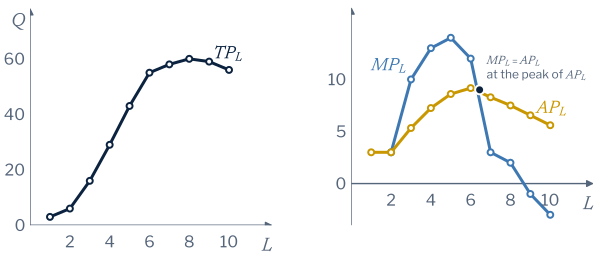

## {.course-title .center background-color="#0C2340" background-image="../theme/title-curves.svg" background-size="cover"}

[Lesson 5]{.lesson-no}

<h1 class="lesson-title">Production</h1>

::: {.lesson-meta}
FIN 30210 Managerial Economics<br>
Jason R. Reed, PhD, University of Notre Dame
:::

# The role of the firm {.section-break background-color="#0C2340" background-image="../theme/section-grid.svg" background-size="cover"}

## Firms turn resources into goods and services

Firms use productive resources (inputs, or factors of production) to make the goods and services that satisfy consumers' "unlimited" wants.

::: {.cols-2}
::: {.col}
[Non-human resources]{.h}
**Land:** gifts of nature, such as raw materials.

**Capital:** not the financial kind. Tools, machines, equipment, and office buildings.
:::

::: {.col}
[Human resources]{.h}
**Labor:** the physical and mental talents of people engaged in production. Labor is unique because its intensity is decided by the worker.

**Entrepreneurial ability:** the person who arranges the renting of land, labor, and capital, makes non-routine decisions, innovates, and refines production techniques.
:::
:::

## Why we assume firms maximize profit

The organizational structure of the firm is assumed to maximize profits.

- Entrepreneurs need an incentive to take risks and take part in commercial activity
- That incentive matters so the right mix of goods and services gets produced for the market
- It can be argued that when the profit motive is diluted, fewer goods and services are produced

# The production function {.section-break background-color="#0C2340" background-image="../theme/section-grid.svg" background-size="cover"}

## The production function

::: {.definition}
[The production function]{.term}
The technological relationship that describes how factors of production are efficiently transformed into goods and services.
:::

In general, output $Q$ is a function of its inputs:

$$
Q = f(K, L, M)
$$

where $K$, $L$, and $M$ are capital, labor, and land.

## Simplifying to labor and capital

- Firms in a competitive environment strive to produce at the **lowest possible cost**
  - That is, efficiently, or cost-efficiently
  - Firms maximize profits by minimizing costs
- Let's simplify further, so we only choose labor and capital: $Q = f(K, L)$
- Labor and capital can substitute for one another, depending heavily on how substitutable they are and on the wage and the rental price of capital

::: notes
Equivalently, a firm that operates efficiently will choose the combination of inputs that maximizes production for a given operating budget.

The production function defines the maximum output obtainable from a particular combination of inputs.

Input prices must be combined with the production function to decide which of the many possible input combinations is best given the firm's objectives, such as profit maximization.
:::

## The Cobb-Douglas production function

Production functions tend to be highly specialized and unique to each firm, but we can approximate the relationship of inputs to outputs with regression.

One of the most widely used production functions in theoretical and empirical work is the **Cobb-Douglas (CD) production function**. For two inputs:

::: {.equation}
$$
Q = AK^{\alpha}L^{\beta}
$$
:::

$\alpha$ and $\beta$ are known parameters, and $K$ and $L$ are capital and labor. $A$ is **total factor productivity**: the output not attributed to capital and labor.

## What the Cobb-Douglas function lets us study

Suppose $Q = 25K^{0.5}L^{0.5}$. There are infinitely many combinations of capital and labor that make 8 units (as long as they're divisible). How do we know which is best?

The CD production function lets us analyze three properties of the production process:

::: {.cols-3}
::: {.col}
[Substitutability between inputs]{.h}
:::

::: {.col}
[Returns to scale]{.h}
:::

::: {.col}
[Diminishing marginal product]{.h}
:::
:::

## Substitutability

- This is the fundamental economic problem of constrained optimization
- Managers tend to face specific input constraints
- Managers are likely to adjust their mix of inputs as input prices change: think automation and outsourcing

## Returns to scale

**Returns to scale** measure the change in output from a common change, $z$, in all inputs:

$$
Q(zK, zL) = (zK)^{\alpha}(zL)^{\beta} = z^{\alpha+\beta}K^{\alpha}L^{\beta} = z^{\alpha+\beta}\,Q
$$

::: {.terms}
::: {.t}
Constant returns to scale
:::

::: {.d}
Output changes by the same proportion as the inputs: $(zK)^{\alpha}(zL)^{\beta} = zQ$, so $\alpha + \beta = 1$.
:::

::: {.t}
Increasing returns to scale
:::

::: {.d}
Output changes by a *greater* proportion than the inputs: $(zK)^{\alpha}(zL)^{\beta} > zQ$, so $\alpha + \beta > 1$.
:::

::: {.t}
Decreasing returns to scale
:::

::: {.d}
Output changes by a *lesser* proportion than the inputs: $(zK)^{\alpha}(zL)^{\beta} < zQ$, so $\alpha + \beta < 1$.
:::
:::

## Determining returns to scale

::: {.problem}
[Problem 5.0]{.problem-label}

1. Determine the returns to scale for $Q = K^{0.3}L^{0.7}$.
2. Determine the returns to scale for $Q = K^{0.5} + L^{0.5}$.
:::

::: {.solution-step .fragment}
[Part 1]{.label}

::: {.v}
If $K$ and $L$ double, output doubles: constant returns to scale. Also, $\alpha + \beta = 0.3 + 0.7 = 1$.
:::
:::

::: {.solution-step .fragment}
[Part 2]{.label}

::: {.v}
Quadrupling the inputs from $K = L = 1$ to $K = L = 4$ only doubles output (from 2 to 4): decreasing returns to scale.
:::
:::

# The short run and diminishing marginal product {.section-break background-color="#0C2340" background-image="../theme/section-grid.svg" background-size="cover"}

## Short run versus long run

::: {.terms}
::: {.t}
Short run
:::

::: {.d}
A period of time in which at least one factor of production is **fixed**: the lease on an apartment, the machines in your factory, the ovens in a kitchen.
:::

::: {.t}
Long run
:::

::: {.d}
A period of time in which **all** factors of production can vary.
:::
:::

This distinction matters as we turn to diminishing marginal productivity.

## The law of diminishing marginal productivity

::: {.definition}
[Diminishing marginal productivity]{.term}
When at least one input is held fixed while another increases, output also increases, but in successively smaller increments. Output increases, but at a decreasing rate.
:::

The story: adding labor while capital is fixed lets workers specialize (learning on the job), but only up to a point. After that, additional workers crowd each other out and output doesn't grow as fast.

::: notes
Figure 5.1 in the book shows what the 3-D production surface looks like, and how different combinations of inputs can achieve the same level of output.
:::

## A production table

```{=html}
<table class="heat">
<thead><tr><th rowspan="2">Labor<br>(hundreds of hours)</th><th colspan="8">Capital (thousands of units)</th></tr><tr><th>250</th><th class="hl">500</th><th>750</th><th>1,000</th><th>1,250</th><th>1,500</th><th>1,750</th><th>2,000</th></tr></thead><tbody>
<tr><th>1</th><td style="background:#FBF8EE">1</td><td class="hl" style="background:#FAF6E9">3</td><td style="background:#F9F4E3">6</td><td style="background:#F7F0DB">10</td><td style="background:#F5EBCE">16</td><td style="background:#F5EBCE">16</td><td style="background:#F5EBCE">16</td><td style="background:#F6EED4">13</td></tr>
<tr><th>2</th><td style="background:#FBF7EC">2</td><td class="hl" style="background:#F9F4E3">6</td><td style="background:#F5EBCE">16</td><td style="background:#F1E4BD">24</td><td style="background:#EFE0B3">29</td><td style="background:#EFE0B3">29</td><td style="background:#E8D394">44</td><td style="background:#E8D394">44</td></tr>
<tr><th>3</th><td style="background:#FAF5E7">4</td><td class="hl" style="background:#F5EBCE">16</td><td style="background:#EFE0B3">29</td><td style="background:#E8D394">44</td><td style="background:#E3CA7D">55</td><td style="background:#E3CA7D">55</td><td style="background:#E3CA7D">55</td><td style="background:#E6CE87">50</td></tr>
<tr><th>4</th><td style="background:#F9F4E3">6</td><td class="hl" style="background:#EFE0B3">29</td><td style="background:#E8D394">44</td><td style="background:#E3CA7D">55</td><td style="background:#E2C776">58</td><td style="background:#E1C672">60</td><td style="background:#E1C672">60</td><td style="background:#E3CA7D">55</td></tr>
<tr><th>5</th><td style="background:#F5EBCE">16</td><td class="hl" style="background:#E9D496">43</td><td style="background:#E3CA7D">55</td><td style="background:#E1C672">60</td><td style="background:#E1C570">61</td><td style="background:#E0C46E">62</td><td style="background:#E0C46E">62</td><td style="background:#E1C672">60</td></tr>
<tr><th>6</th><td style="background:#EFE0B3">29</td><td class="hl" style="background:#E3CA7D">55</td><td style="background:#E1C672">60</td><td style="background:#E0C46E">62</td><td style="background:#E0C36C">63</td><td style="background:#E0C36C">63</td><td style="background:#E0C36C">63</td><td style="background:#E0C46E">62</td></tr>
<tr><th>7</th><td style="background:#E8D394">44</td><td class="hl" style="background:#E2C776">58</td><td style="background:#E0C46E">62</td><td style="background:#E0C36C">63</td><td style="background:#DFC26A">64</td><td style="background:#DFC26A">64</td><td style="background:#DFC26A">64</td><td style="background:#DFC26A">64</td></tr>
<tr><th>8</th><td style="background:#E6CE87">50</td><td class="hl" style="background:#E1C672">60</td><td style="background:#E0C46E">62</td><td style="background:#E0C36C">63</td><td style="background:#DFC26A">64</td><td style="background:#DFC168">65</td><td style="background:#DFC168">65</td><td style="background:#DFC168">65</td></tr>
<tr><th>9</th><td style="background:#E3CA7D">55</td><td class="hl" style="background:#E2C674">59</td><td style="background:#E1C570">61</td><td style="background:#E0C36C">63</td><td style="background:#DFC26A">64</td><td style="background:#DFC168">65</td><td style="background:#DFC066">66</td><td style="background:#DFC066">66</td></tr>
<tr><th>10</th><td style="background:#E5CC83">52</td><td class="hl" style="background:#E3C97A">56</td><td style="background:#E2C674">59</td><td style="background:#E0C46E">62</td><td style="background:#DFC26A">64</td><td style="background:#DFC168">65</td><td style="background:#DFC066">66</td><td style="background:#DEC063">67</td></tr>
</tbody></table>
```

[Each cell is output. Read down a column to see labor rising with capital fixed.]{.small}

# Total, average, and marginal products {.section-break background-color="#0C2340" background-image="../theme/section-grid.svg" background-size="cover"}

## Total product of labor

Assume we're in the short run: capital is fixed and labor is variable. The production function becomes

$$
Q_L = f(K_0, L) = TP_L
$$

where $Q_L$ is the total product of labor and $K_0$ is a fixed amount of capital. *Total product*, or output, now refers to the **total product of labor**.

## Average and marginal product of labor

::: {.cols-2}
::: {.col}
[Average product of labor]{.h}
Total product per unit of labor:

$$
AP_L = \frac{TP_L}{L} = \frac{Q_L}{L} = \frac{f(K_0, L)}{L}
$$

Not every unit of labor is equally productive, so $AP_L$ describes the average worker.
:::

::: {.col}
[Marginal product of labor]{.h}
The change in output from a small change in labor, $MP_L = \Delta Q / \Delta L$. We'll use the first partial derivative:

$$
MP_L = \frac{\partial TP_L}{\partial L} = \frac{\partial Q_L}{\partial L} = \frac{\partial f(K_0, L)}{\partial L}
$$

Holding labor fixed instead gives the same relationships for capital.
:::
:::

## Marginal products with Cobb-Douglas

::: {.problem}
[Problem 5.1]{.problem-label}
Given the production function $Q = 100K^{0.6}L^{0.4}$, find the marginal product of capital and the marginal product of labor when $K = 25$ and $L = 100$.
:::

::: {.eq-steps}
::: {.fragment}
$$
\frac{\partial Q}{\partial K} = MP_K = 60K^{-0.4}L^{0.4} = 60(25)^{-0.4}(100)^{0.4} = 104.47
$$
:::

::: {.fragment}
$$
\frac{\partial Q}{\partial L} = MP_L = 40K^{0.6}L^{-0.6} = 40(25)^{0.6}(100)^{-0.6} = 17.41
$$
:::
:::

## Total, average, and marginal product in the table

::: {.compact}

| $L$ | 1 | 2 | 3 | 4 | 5 | 6 | 7 | 8 | 9 | 10 |
|:---|---:|---:|---:|---:|---:|---:|---:|---:|---:|---:|
| $Q$ | 3 | 6 | 16 | 29 | 43 | 55 | 58 | 60 | 59 | 56 |
| $MP_L$ | | 3 | 10 | 13 | 14 | 12 | 3 | 2 | −1 | −3 |
| $AP_L$ | 3.00 | 3.00 | 5.33 | 7.25 | 8.60 | 9.17 | 8.29 | 7.50 | 6.56 | 5.60 |

:::

::: {.figure-wide .shorter}
{fig-alt="Left: total product rises steeply, levels off near 60, then dips. Right: marginal product rises to 14, then falls below zero; average product peaks near 9 where marginal product crosses it."}
:::

[Capital fixed at 500, the highlighted column of the production table.]{.small}

## Increasing, diminishing, and negative marginal product

Output increases at an increasing rate, then at a decreasing rate, and then falls.

::: {.terms}
::: {.t}
Increasing marginal product
:::

::: {.d}
Output increases at an increasing rate: $\dfrac{\partial Q}{\partial L} > 0$ and $\dfrac{\partial^2 Q}{\partial L^2} > 0$
:::

::: {.t}
Diminishing marginal product
:::

::: {.d}
Output increases at a decreasing rate: $\dfrac{\partial Q}{\partial L} > 0$ and $\dfrac{\partial^2 Q}{\partial L^2} < 0$
:::

::: {.t}
Negative marginal product
:::

::: {.d}
Output begins to decline: $\dfrac{\partial Q}{\partial L} < 0$
:::
:::

## Verifying diminishing marginal product

::: {.problem}
[Problem 5.2]{.problem-label}
For the Cobb-Douglas production function $Q = 25K^{0.5}L^{0.5}$, verify that diminishing marginal returns to labor exist when $K = L = 16$.
:::

::: {.eq-steps}
::: {.fragment}
$$
\frac{\partial Q}{\partial L} = 12.5K^{0.5}L^{-0.5} = 12.5(16)^{0.5}(16)^{-0.5} = 12.5 > 0
$$
:::

::: {.fragment}
$$
\frac{\partial^2 Q}{\partial L^2} = -6.25K^{0.5}L^{-1.5} = -6.25(16)^{0.5}(16)^{-1.5} = -0.39 < 0
$$
:::
:::

::: {.takeaway .fragment}
The first derivative is positive and the second is negative, so diminishing marginal product exists.
:::

## Where average product peaks

To link average product and marginal product for any variable input, take the derivative of $AP_L = Q_L / L$ with respect to labor and set it equal to zero:

::: {.eq-steps}
$$
\frac{\partial AP_L}{\partial L} = \frac{L\left(\frac{\partial Q_L}{\partial L}\right) - Q_L\left(\frac{\partial L}{\partial L}\right)}{L^2} = \frac{1}{L}\left(MP_L - \frac{Q_L}{L}\right) = 0
$$

::: {.fragment}
$$
\Rightarrow\; MP_L = AP_L \quad \text{at the maximum of } AP_L
$$
:::
:::

::: {.takeaway .fragment}
When the average product of labor is at its maximum, the marginal product of labor equals the average product of labor.
:::

## Marginal pulls the average

- When a marginal value is **greater** than the average, the average is **rising**
- When a marginal value is **less** than the average, the average is **falling**
- When a marginal value **equals** the average, the average is at a **stationary value**

::: {.prompt}
You average 8 on your quizzes, then score a 9 on the next one. What happens to your average?
:::

::: {.fragment .takeaway}
Marginal is above average, so the average goes up.
:::

## {.next-up .center background-color="#0C2340" background-image="../theme/section-grid.svg" background-size="cover"}

[Up next: Lesson 6]{.lesson-no}

<h1>Production, Part 2</h1>

::: {.next-links}
[Open Lesson 6](lesson-06.html) [All lessons](../index.html)
:::
