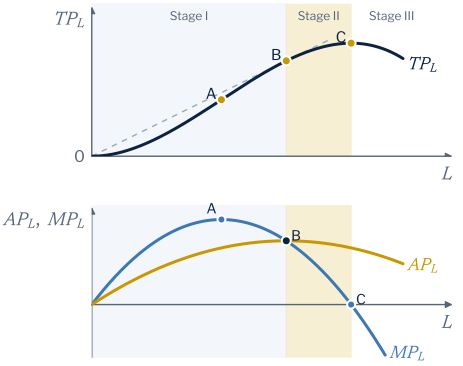
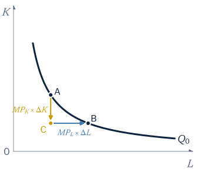
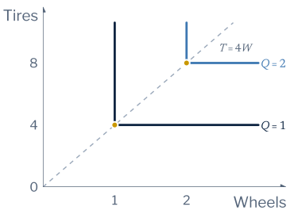
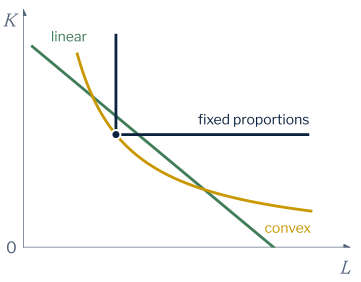

## {.course-title .center background-color="#0C2340" background-image="../theme/title-curves.svg" background-size="cover"}

[Lesson 6]{.lesson-no}

<h1 class="lesson-title">Production, Part 2</h1>

::: {.lesson-meta}
FIN 30210 Managerial Economics 
Jason R. Reed, PhD, University of Notre Dame
:::

# Output elasticity {.section-break background-color="#0C2340" background-image="../theme/section-grid.svg" background-size="cover"}

## The output elasticity of labor

::: {.definition}
[Output elasticity of labor]{.term}
The percentage change in output from a percentage change in labor.
:::

::: {.equation}
$$
\varepsilon_L = \frac{\%\,\Delta Q}{\%\,\Delta L} = \left(\frac{\partial Q_L}{\partial L}\right)\left(\frac{L}{Q_L}\right) = MP_L\left(\frac{1}{AP_L}\right) = \frac{MP_L}{AP_L}
$$
:::

It's the ratio of the marginal product of labor to the average product of labor.

## Two questions about Cobb-Douglas

Suppose we have the Cobb-Douglas production function

$$
Q = AK^{\alpha}L^{\beta}, \quad \text{where } 0 < \alpha < 1,\; 0 < \beta < 1, \text{ and } A > 0
$$

1. How can we show that the law of diminishing marginal product holds?
2. Holding capital constant, what's the proportional change in output from a proportional change in labor?

## Diminishing marginal product of labor

For diminishing marginal returns, take the first and second derivatives, as before:

::: {.eq-steps}
::: {.fragment}
$$
MP_L = \frac{\partial Q}{\partial L} = \beta AK^{\alpha}L^{\beta - 1} = \frac{\beta AK^{\alpha}L^{\beta}}{L} = \frac{\beta Q}{L} > 0
$$
:::

::: {.fragment}
$$
MP_L' = \frac{\partial^2 Q}{\partial L^2} = \beta(\beta - 1)AK^{\alpha}L^{\beta - 2} = \frac{\beta(\beta - 1)AK^{\alpha}L^{\beta}}{L^2} = \frac{\beta(\beta - 1)Q}{L^2} < 0
$$
:::
:::

::: {.fragment .small}
The second derivative is negative because $0 < \beta < 1$ makes $\beta - 1 < 0$.
:::

## The exponents are the output elasticities

::: {.equation}
$$
\varepsilon_L = \left(\frac{\partial Q_L}{\partial L}\right)\left(\frac{L}{Q_L}\right) = \frac{MP_L}{AP_L} = \left(\frac{\beta Q}{L}\right)\left(\frac{L}{Q}\right) = \beta
$$
:::

::: {.takeaway}
For Cobb-Douglas production functions, the exponent on each input is that input's output elasticity.
:::

## Output elasticity of capital

::: {.problem}
[Problem 6.0]{.problem-label}
Given the production function $Q = 10K^{0.5} + 2L$, with $K = 4$ and $L = 2$, what is the output elasticity of capital?
:::

::: {.eq-steps .fragment}
$$
Q = 10(4)^{0.5} + 2(2) = 24
$$

$$
\varepsilon_K = \frac{\partial Q}{\partial K} \cdot \frac{K}{Q} = 5K^{-0.5} \cdot \frac{K}{Q} = 5(4)^{-0.5} \cdot \frac{4}{24} = 0.42
$$
:::

# The three stages of production {.section-break background-color="#0C2340" background-image="../theme/section-grid.svg" background-size="cover"}

## How total, average, and marginal product relate

::: {.split .text-left}
::: {.col}
- $TP_L$ is at its maximum where $MP_L = 0$
- $AP_L$ is at its maximum where $MP_L = AP_L$
- $MP_L$ is at its maximum at the inflection point of $TP_L$, where $\dfrac{\partial MP_L}{\partial L} = 0$

[The top panel is total product. The bottom panel is marginal and average product.]{.small}
:::

{fig-alt="Top: total product curves upward to inflection point A, passes point B where a ray from the origin is tangent, and peaks at C. Bottom: marginal product peaks at A, crosses average product at B, and hits zero at C. Stage I runs to B, Stage II from B to C, Stage III beyond C."}
:::

::: notes
From the origin to A, we see increasing marginal returns; A is the inflection point where diminishing marginal returns begin. From A to C the marginal product of labor is positive; beyond C it's negative.

In panel B, the peak of the marginal product curve lines up with the inflection point, and the point where marginal product turns negative lines up with the peak of total product.

Measuring the slope of a ray from the origin, point B has the steepest one. That's where average product of labor is at its maximum.

The intersection of MP and AP of labor is point B, where the slope of TP and the ray from the origin are identical.
:::

## The three stages of production

::: {.terms}
::: {.t}
Stage I
:::

::: {.d}
$MP > AP$, so adding labor pulls average productivity up. If wages and rental prices stay constant, more labor makes the average worker more productive and raises average profit per worker. *Firms wouldn't stop here, since profits could be higher if they kept raising average productivity.*
:::

::: {.t}
Stage II
:::

::: {.d}
$MP$ is positive but less than $AP$, so added labor pulls $AP$ down. With diminishing marginal product, average revenue and profit per worker are falling. *This is where firms want to employ labor and produce.*
:::

::: {.t}
Stage III
:::

::: {.d}
Begins where $MP < 0$ and continues indefinitely. Average profits fall as labor increases because marginal product is negative. *As with Stage I, production won't take place here.*
:::
:::

::: {.takeaway}
Capital and labor will be within the boundaries of Stage II. We don't know the exact amounts yet.
:::

# Isoquants {.section-break background-color="#0C2340" background-image="../theme/section-grid.svg" background-size="cover"}

## Isoquants

An **isoquant** is the combination of capital and labor (or any other set of inputs) necessary to produce a fixed level of output.

- If inputs are divisible, there are infinitely many possibilities
- To graph or solve for an isoquant, select a fixed level of output, $Q = Q_0$:

$$
Q = Q_0 = f(K, L)
$$

## Solving for an isoquant

Take $Q = 15K^{0.5}L^{0.75}$. Once $Q$ is fixed, solve for $K$ in terms of $L$ (or $L$ in terms of $K$).

::: {.eq-steps}
Let $Q = 200$: $\quad 200 = 15K^{0.5}L^{0.75}$

::: {.fragment}
Isolate $K$: $\quad \dfrac{200}{15L^{0.75}} = K^{0.5} \;\Rightarrow\; K = \left(\dfrac{200}{15L^{0.75}}\right)^{\frac{1}{0.5}}$
:::

::: {.fragment}
$$
K = \left(\frac{200}{15}\right)^2 L^{-1.5}
$$
:::
:::

::: {.takeaway .fragment}
This is the equation of the isoquant.
:::

## The marginal rate of technical substitution

*Iso* means equal and *quant* means quantity. We now treat capital, $K$, as the dependent variable and labor, $L$, as the independent variable, which lets us **substitute** between them.

The **slope** of the isoquant measures the substitution between capital and labor when output is fixed. That slope is the **marginal rate of technical substitution (MRTS)**:

::: {.equation}
$$
MRTS_{KL} = \frac{\partial K}{\partial L} = -\frac{MP_L}{MP_K}
$$
:::

## Moving along an isoquant

::: {.split}
{fig-alt="A convex isoquant with points A and B. A detour through point C shows capital falling from A to C, then labor rising from C to B."}

::: {.col}
- Moving from A to B leaves output unchanged at $Q = Q_0$: every point on the isoquant is the same output
- Picture moving from A down to C, then across to B
  - $MP_K \Delta K < 0$
  - $MP_L \Delta L > 0$
- A change in capital has to be met with the productive equivalent in labor
:::
:::

## Finding the MRTS two ways

::: {.problem}
[Problem 6.1]{.problem-label}
Given $Q = 15K^{0.5}L^{0.75}$, solve for $MRTS_{LK}$ using both methods when $Q = Q_0$.
:::

::: {.solution-step .fragment}
[Solve the isoquant, then differentiate]{.label}

::: {.v}
$L = \left(\dfrac{Q_0 K^{-0.5}}{15}\right)^{\frac{1}{0.75}} = \left(\dfrac{Q_0}{15}\right)^{\frac{4}{3}} K^{-\frac{2}{3}} \;\Rightarrow\; MRTS_{LK} = \dfrac{dL}{dK} = -\dfrac{2}{3}\left(\dfrac{Q_0}{15}\right)^{\frac{4}{3}} K^{-\frac{5}{3}}$
:::
:::

::: {.solution-step .fragment}
[Take the ratio of marginal products]{.label}

::: {.v}
$MRTS_{LK} = -\dfrac{MP_K}{MP_L} = -\dfrac{\left(\frac{1}{2}\right)15K^{-0.5}L^{0.75}}{\left(\frac{3}{4}\right)15K^{0.5}L^{-0.25}} = -\dfrac{2}{3}\cdot\dfrac{L}{K}$
:::
:::

::: {.fragment .small}
Substituting the isoquant for $L$ in the second answer gives the first.
:::

## Isoquants are convex

The relationship highlights a mathematical property of isoquants: they're **convex**.

$$
\frac{dK}{dL} < 0 \quad \text{and} \quad \frac{d^2K}{dL^2} > 0
$$

- As we keep giving up capital for labor, it takes *more and more* labor to replace the lost productivity of capital, because of diminishing marginal productivity of labor: a decreasing degree of substitutability
- If inputs were perfectly substitutable, we'd have a **linear isoquant**, with no decreasing substitutability:

$$
\frac{dK}{dL} < 0 \quad \text{and} \quad \frac{d^2K}{dL^2} = 0
$$

## Fixed-input isoquants

::: {.split .text-left}
::: {.col}
- An "L" shape, with $MRTS_{KL}$ undefined at the corner
- Left and right shoes, a chemical process with fixed proportions, four tires and a steering wheel
- The **Leontief** production function uses the minimum input proportions: $Q = \min(K, L)$ when inputs are used one-for-one
- "min" means the minimum amount of inputs available, not minimize
:::

{fig-alt="L-shaped isoquants for one and two cars, with corners at 1 wheel and 4 tires and at 2 wheels and 8 tires, lying on the ray T = 4W."}
:::

## Fixed proportions: building a car

To build a car we need 4 tires and 1 steering wheel. Suppose we have 6 tires and 2 wheels.

$$
Q = \min\left(\tfrac{1}{4}\,\text{Tires},\; \tfrac{1}{1}\,\text{Wheels}\right)
$$

::: {.fragment}
$$
Q = \min\left(\tfrac{1}{4}(6),\; \tfrac{1}{1}(2)\right) = \min(1.5,\; 2) = 1.5 \text{ cars}
$$

Or 1 car, if we need whole units. Every efficient input combination lies on the ray through the origin where $\tfrac{1}{4}\text{Tires} = \text{Wheels}$, or $T = 4W$.
:::

## Three kinds of isoquant

::: {.split}
{fig-alt="A linear isoquant, an L-shaped fixed-proportions isoquant, and a convex isoquant, all passing through the same point."}

::: {.col}
Start from the same point and make equal reductions in capital.

- **Linear:** substitute equal amounts of labor
- **Fixed proportions:** there's no substitution
- **Convex:** substitute increasing amounts of labor
:::
:::

## Proving an isoquant is convex

::: {.problem}
[Problem 5.5]{.problem-label}
The general Cobb-Douglas production function is $Q = AK^{\alpha}L^{\beta}$, where $A > 0$, $0 < \alpha < 1$, and $0 < \beta < 1$.

1. Derive an equation for an isoquant with $K$ in terms of $L$.
2. Show that this isoquant is convex (bowed in) toward the origin.
:::

## Problem 5.5: solution

::: {.solution-step .fragment}
[Isoquant]{.label}

::: {.v}
Fix output at $Q_0 = AK^{\alpha}L^{\beta}$. Then $K^{\alpha} = Q_0 A^{-1} L^{-\beta}$, so $K = Q_0^{1/\alpha} A^{-1/\alpha} L^{-\beta/\alpha}$.
:::
:::

::: {.solution-step .fragment}
[Downward sloping]{.label}

::: {.v}
$\dfrac{\partial K}{\partial L} = \left(-\dfrac{\beta}{\alpha}\right) Q_0^{1/\alpha} A^{-1/\alpha} L^{-\beta/\alpha - 1} < 0$, since $-\beta/\alpha < 0$ and the rest is positive.
:::
:::

::: {.solution-step .fragment}
[Convex]{.label}

::: {.v}
$\dfrac{\partial^2 K}{\partial L^2} = \left[-\dfrac{\beta}{\alpha} - 1\right]\left(-\dfrac{\beta}{\alpha}\right) Q_0^{1/\alpha} A^{-1/\alpha} L^{-\beta/\alpha - 2} > 0$, since the product of the two negative brackets is positive.
:::
:::

# Estimating production functions {.section-break background-color="#0C2340" background-image="../theme/section-grid.svg" background-size="cover"}

## Estimating production functions

We need an estimation technique.

- For now, we only have the skills to use OLS, and that's fine: ordinary least squares is a huge workhorse in econometrics
- To use OLS we need a linear function, with a dependent variable and $n$ independent variables. Cobb-Douglas isn't linear:

$$
Q = AK^{\alpha}L^{\beta}
$$

## Linearizing Cobb-Douglas

Take the natural log of each variable:

$$
\ln Q = \ln A + \alpha \ln K + \beta \ln L
$$

- Run the OLS regression with Excel's Data Analysis toolpak
  - First look at scatterplots of the variables to judge whether Cobb-Douglas is appropriate
  - Add quadratic and logarithmic trend lines to look for decreasing returns
- The coefficients now represent percentage changes
  - Use a $t$-test to determine the returns to scale, $H_0\!: \beta_1 + \beta_2 + \cdots + \beta_n = 1$
  - With two factors, we can also test restrictions such as $\beta_L - 2\beta_K = 0$
- If we're satisfied with this form, we can build the isoquant to set the output level and decide how many of each input to use

## {.next-up .center background-color="#0C2340" background-image="../theme/section-grid.svg" background-size="cover"}

[Up next: Lesson 7]{.lesson-no}

<h1>Costs</h1>

::: {.next-links}
[Open Lesson 7](lesson-07.html) [All lessons](../index.html)
:::
