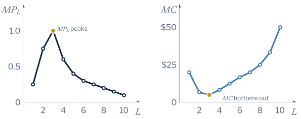
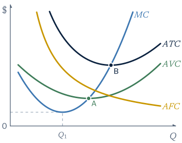
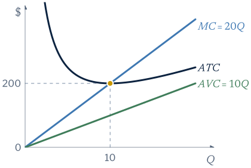
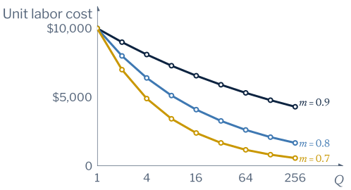
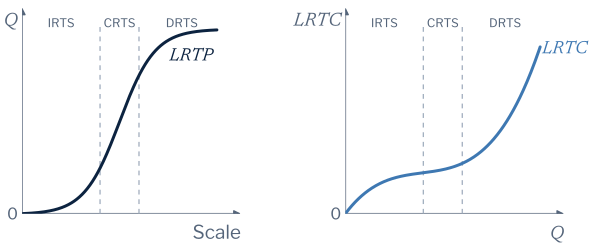
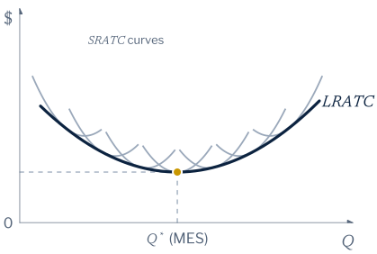
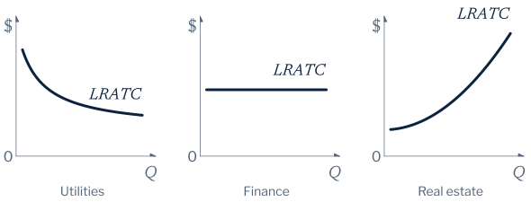
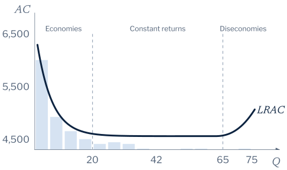

## {.course-title .center background-color="#0C2340" background-image="../theme/title-curves.svg" background-size="cover"}

[Lesson 7]{.lesson-no}

<h1 class="lesson-title">Costs</h1>

::: {.lesson-meta}
FIN 30210 Managerial Economics 
Jason R. Reed, PhD, University of Notre Dame
:::

# Short-run costs {.section-break background-color="#0C2340" background-image="../theme/section-grid.svg" background-size="cover"}

## Costs connect production to profit

- We've already outlined the difference between explicit and implicit costs, and between economic and accounting profit
- This lesson links the theory of costs to the underlying production technology
- That link is our route to profit maximization

## Total cost depends on the inputs

Total cost is a function of the production level $Q$:

$$
TC = f(Q)
$$

More generally, since output is itself a function of the inputs,

$$
TC = f\big(g(K_0, L)\big)
$$

Costs are a function of our productive inputs.

::: notes
We want to express costs in terms of our inputs, capital and labor. Essentially, total cost is a function of output, which is a function of capital and labor.
:::

## Pricing the inputs

Assume input prices are set in competitive markets. Then

$$
TC = P_K K_0 + P_L L
$$

where $P_K$ is the rental price of capital and $P_L$ is the wage rate. Capital is the *fixed* input and labor is the *variable* input.

Total cost is now a combination of fixed and variable costs:

::: {.equation}
$$
TC(Q) = TFC + TVC(Q)
$$
:::

::: notes
For this class we'll assume rental prices are determined in an outside market; estimating them is beyond the scope of the class, so we take them as given. We generally call the rental price of labor the wage.

Notice that only TVC depends on changes in quantity.
:::

## Fixed and variable costs

::: {.cols-2}
::: {.col}
[Total fixed costs (TFC)]{.h}
Come from acquiring and maintaining fixed factors of production. They're incurred whatever the level of production: binding contracts, rent on office space, insurance, legal retainers.
:::

::: {.col}
[Total variable costs (TVC)]{.h}
Come from acquiring and maintaining variable factors of production. In Stages I and II of production, we assume TVC increases as output increases.
:::
:::

## Average and marginal costs

::: {.terms}
::: {.t}
Average fixed cost
:::

::: {.d}
$AFC = \dfrac{TFC}{Q}$
:::

::: {.t}
Average variable cost
:::

::: {.d}
$AVC = \dfrac{TVC}{Q}$
:::

::: {.t}
Average total cost
:::

::: {.d}
$ATC = \dfrac{TC}{Q} = \dfrac{TFC + TVC}{Q}$
:::

::: {.t}
Marginal cost
:::

::: {.d}
$MC = \dfrac{dTC}{dQ} = \dfrac{dTVC}{dQ}$
:::
:::

::: notes
ATC, AFC, and AVC are all measured per unit of production. MC is the change in total cost from a change in output. Remember, though, that output is a function of capital and labor, so be careful with this mathematical definition.
:::

## Sunk costs

**Sunk costs** are paid whether or not any output is produced.

- They don't change with management decisions
- They're not the same as fixed costs
  - Buy a factory for \$1 million. If you make nothing, your fixed cost is \$1 million. Sell the factory for \$750,000, and you've permanently lost \$250,000: that's your sunk cost
  - Sunk cost is the difference between the purchase price and the salvage value

::: {.takeaway}
All sunk costs are fixed costs, but not all fixed costs are sunk.
:::

## Marginal cost and marginal product are scaled inverses

Increasing and diminishing marginal product also drive the shape of the total cost function.

$$
MC = \frac{dTC}{dQ} = \left(\frac{dTC}{dQ}\right)\left(\frac{dL}{dL}\right) = \left(\frac{dTC}{dL}\right)\left(\frac{dL}{dQ}\right)
$$

::: {.fragment}
Let $TC = P_L L + P_K K$. With capital fixed, $dTC/dL = P_L$ and $dL/dQ = 1/MP_L$, so

::: {.equation}
$$
MC = P_L\left(\frac{1}{MP_L}\right)
$$
:::
:::

## When marginal product falls, marginal cost rises

::: {.figure-wide .short}
{fig-alt="Left: marginal product of labor rises to a peak of 1.0 at three units of labor, then falls. Right: marginal cost falls to its minimum of 5 dollars at three units of labor, then rises to 50 dollars."}
:::

When $MP_L$ begins to decline, $MC$ begins to rise: diminishing marginal productivity has set in.

[Marginal cost here is a wage of \$5 divided by the marginal product of labor.]{.small}

## The short-run cost curves

::: {.split}
{fig-alt="U-shaped MC, ATC, and AVC curves and a falling AFC curve. MC reaches its minimum at Q1, then crosses AVC at its minimum, point A, and ATC at its minimum, point B."}

::: {.col}
The cost curves take these shapes because the production function has increasing and then diminishing marginal product.

- From 0 to $Q_1$: increasing marginal product, so $MC$ falls
- Beyond $Q_1$: diminishing marginal product, so $MC$ rises
- $MC$ crosses $AVC$ at its minimum (A) and $ATC$ at its minimum (B)
:::
:::

::: notes
Underlying the short-run cost functions are the short-run production functions. Q1 is the minimum of MC.
:::

## Calculating the costs

::: {.problem}
[Problem 7.1]{.problem-label}
A firm's total cost function is $TC = 12 + 60Q - 15Q^2 + Q^3$. If the firm produces $Q = 10$, calculate TFC, TVC, ATC, AFC, AVC, and MC.
:::

::: {.eq-grid .fragment}
$$
\begin{aligned}
TFC &= 12 \\
TVC &= 60(10) - 15(10)^2 + (10)^3 = 100 \\
ATC &= \tfrac{12}{10} + 60 - 15(10) + (10)^2 = 11.2
\end{aligned}
$$

$$
\begin{aligned}
AFC &= \tfrac{12}{10} = 1.2 \\
AVC &= 60 - 15(10) + (10)^2 = 10 \\
MC &= 60 - 30(10) + 3(10)^2 = 60
\end{aligned}
$$
:::

## Where average total cost is lowest

As with productivity, there's a link between the marginal and the average. We use the same strategy, but now we *minimize*.

::: {.eq-steps}
$$
ATC = \frac{TC}{Q} \qquad \frac{dATC}{dQ} = \frac{Q\left(\frac{dTC}{dQ}\right) - TC}{Q^2} = \frac{1}{Q}\left(MC - ATC\right) = 0
$$
:::

::: {.takeaway}
At the minimum of ATC, $MC = ATC$.
:::

::: notes
We can verify that the second derivative is positive, which is sufficient to identify a minimum.
:::

## MC equals ATC at the minimum

::: {.split .text-left}
::: {.col}
::: {.problem}
[Problem 7.2]{.problem-label}
A firm faces $TC = 1000 + 10Q^2$.

1. What output minimizes ATC? Verify that $MC = ATC$ there.
2. What output minimizes AVC?
:::

::: {.eq-steps .fragment}
$ATC = 1000Q^{-1} + 10Q$

$\dfrac{dATC}{dQ} = -1000Q^{-2} + 10 = 0 \Rightarrow Q = 10$

$MC = 20Q = 200 = ATC$ at $Q = 10$
:::

::: {.fragment .small}
$AVC = 10Q$ only rises, so it's lowest at the first unit.
:::
:::

::: {.fragment}
{fig-alt="ATC falls then rises with a minimum of 200 at Q equals 10, where the MC line 20Q crosses it. AVC is the line 10Q."}
:::
:::

# The learning curve {.section-break background-color="#0C2340" background-image="../theme/section-grid.svg" background-size="cover"}

## Workers get better with experience

- So far we've assumed every additional unit of labor is identical. Does that seem plausible? Not really.
- Now assume the typical worker gets better with experience
- At constant labor prices, per-unit labor costs can then fall: think employee training and continuing education

## The learning curve effect

The **learning curve effect** is the relationship between rising per-worker productivity, and falling per-unit cost at fixed labor prices, as output and experience accumulate.

$$
\text{Cost of the } Q\text{th unit} = (\text{cost of the 1st unit}) \times (\text{amount produced})^{\text{rate of cost reduction}}
$$

::: {.equation}
$$
\Gamma = \phi Q^{\beta}, \qquad \beta = \frac{\ln(m)}{\ln(\lambda)}
$$
:::

$\phi$ is the per-unit cost of the first unit, $Q$ is output, $m$ is the learning factor, and $\lambda$ is the factor of proportionality.

::: notes
The learning curve effect measures the relationship between an increase in per-worker productivity (a decrease in per-unit labor cost at fixed labor prices) and the improvement in labor skills from on-the-job experience.
:::

## Reading the learning factor

- $\beta$ measures the learning effect
- Think of $m$ as the rate at which workers learn. It takes values $0 \le m \le 1$
- As $m$ approaches zero, the learning curve effect becomes more powerful

::: {.prompt}
What happens to per-unit labor cost when $m = 0$?
:::

::: notes
When m = 0, per-unit labor costs fall to zero.
:::

## Learning curves in practice

::: {.split .text-left}
::: {.compact}

| Output | $m = 0.9$ | $m = 0.8$ | $m = 0.7$ |
|---:|---:|---:|---:|
| 1 | \$10,000 | \$10,000 | \$10,000 |
| 2 | 9,000 | 8,000 | 7,000 |
| 4 | 8,100 | 6,400 | 4,900 |
| 8 | 7,290 | 5,120 | 3,430 |
| 16 | 6,561 | 4,096 | 2,401 |
| 32 | 5,904.90 | 3,276.80 | 1,680.70 |
| 64 | 5,314.41 | 2,621.44 | 1,176.49 |
| 128 | 4,782.97 | 2,097.15 | 823.54 |
| 256 | 4,304.67 | 1,677.72 | 576.48 |

:::

{fig-alt="Unit labor cost falls from 10,000 dollars as output doubles, fastest for m = 0.7 and slowest for m = 0.9."}
:::

[Factor of proportionality fixed at 2. Learning effects usually come from skills built on repetitive tasks.]{.small}

## Estimating a learning curve

::: {.problem}
[Problem 7.1]{.problem-label}
The labor cost of producing a single unit of output is \$5,000.

1. If the learning factor is 0.74 and the factor of proportionality is 2.5, estimate the per-unit labor cost of producing 120 units.
2. If the wage is constant at \$15 an hour, how many labor hours does the first unit take? How many per unit when 120 units are produced?
:::

::: {.solution-step .fragment}
[Per-unit cost]{.label}

::: {.v}
$\Gamma = (\$5{,}000)(120)^{\ln(0.74)/\ln(2.5)} = \$1{,}036.90$
:::
:::

::: {.solution-step .fragment}
[Labor hours]{.label}

::: {.v}
First unit: $\$5{,}000 \div \$15 = 333.33$ hours. At 120 units: $\$1{,}036.90 \div \$15 = 69.1$ hours per unit.
:::
:::

# Long-run costs {.section-break background-color="#0C2340" background-image="../theme/section-grid.svg" background-size="cover"}

## The long run

- The long run is when all factors of production are variable
  - *There's no long-run equivalent of the law of diminishing marginal product*
- As in the short run, long-run production functions are closely tied to long-run cost functions
- We can develop a **long-run total product function (LRTP)**

## Long-run total product and total cost

::: {.figure-wide .short}
{fig-alt="Left: long-run total product rises slowly, then steeply, then levels off, across regions of increasing, constant, and decreasing returns to scale. Right: long-run total cost rises quickly, flattens, then rises steeply across the same regions."}
:::

- We still use output elasticities to measure returns to scale
- The short-run and long-run total product functions look alike, but for different reasons
- Long-run total cost (LRTC) looks a lot like short-run total cost, with **no fixed costs**

## Why returns to scale change

::: {.cols-2}
::: {.col}
[Increasing returns to scale]{.h}
Firms gain from specializing both human and non-human inputs: in-house lawyers, accountants, and economists; large-capacity equipment that's more efficient than small machinery.
:::

::: {.col}
[Decreasing returns to scale]{.h}
As firms grow, the efficiencies of size run out: more administrative layers, internal coordination problems, inflexible operations, transportation costs.
:::
:::

## Economies of scale

*Scale* refers to the size of the firm. Does the size of a firm's operation affect its average costs of production?

::: {.cols-3}
::: {.col}
[Economies of scale]{.h}
Think increasing returns to scale: LRATC declines.
:::

::: {.col}
[Constant returns to scale]{.h}
LRATC neither rises nor falls.
:::

::: {.col}
[Diseconomies of scale]{.h}
Think decreasing returns to scale: LRATC rises.
:::
:::

::: notes
Economies of scale: if factor prices are constant, total cost rises in proportion to total factor usage, but per-unit cost falls because output has increased more than proportionately.

For example, large firms may get more favorable financing, and large electrical generators are more efficient at higher output.
:::

## The long-run average cost curve

::: {.split .text-left}
::: {.col}
- Planning for the long run, a firm can choose how much fixed capital it will have in each short run
- That gives a set of possible SRATC curves, based on estimates of future demand
- The firm still wants to minimize per-unit costs, so the LRATC curve **envelopes** the SRATC curves
- **Minimum efficient scale (MES)** is the minimum of the LRATC
:::

{fig-alt="Several small U-shaped short-run average cost curves, each tangent to a larger U-shaped long-run average cost curve. The minimum of the long-run curve is the minimum efficient scale."}
:::

::: notes
The shape is set by the returns to scale. The minimum of long-run ATC is commonly called the minimum efficient scale.
:::

## LRATC doesn't have to be U-shaped

::: {.figure-wide .shorter}
{fig-alt="Three long-run average cost curves: falling for utilities, flat for finance, and rising for real estate."}
:::

There's no *a priori* reason for a U-shape. Industry characteristics shape the curve.

::: {.compact}

| Industry | Top 50 firms' share | Top 8 firms' share |
|:---|---:|---:|
| Utilities | 70% | 22% |
| Finance | 45% | 16% |
| Real estate | 25% | 8% |

:::

## Evidence: electric utilities

::: {.figure-wide}
{fig-alt="Industry long-run average cost per 1,000 kilowatt-hours falls steeply up to about 20 billion kilowatt-hours, stays flat to about 65, then rises. Bars show that most of the 114 firms are small."}
:::

Data on 114 electric utilities give this industry LRAC. Average cost per 1,000 kWh is on the vertical axis and output in billions of kWh is on the horizontal; the bars show how many firms operate at each size, most of them small.

## Finding minimum efficient scale

::: {.problem}
[Problem 7.2]{.problem-label}
A firm's long-run total cost equation is estimated as $LRTC = 2{,}000Q - 5Q^2 + 0.005Q^3$. What is its long-run average cost equation, and what is its minimum efficient scale?
:::

::: {.eq-steps .fragment}
$$
LRATC = \frac{LRTC}{Q} = 2{,}000 - 5Q + 0.005Q^2
$$

$$
\frac{dLRATC}{dQ} = -5 + 0.01Q = 0 \;\Rightarrow\; Q_{MES} = \frac{5}{0.01} = 500
$$
:::

# Multiproduct cost functions {.section-break background-color="#0C2340" background-image="../theme/section-grid.svg" background-size="cover"}

## Firms that make more than one thing

It's restrictive to assume firms make only one product: Ford makes cars and trucks, Dow makes a variety of chemicals. A general two-good cost function is

$$
TC = TC(Q_1, Q_2)
$$

Assume the firm uses the same production facilities to make both. There will clearly be cost relationships between the two goods:

- Economies of scope
- Cost complementarities

## Economies of scope and cost complementarities

::: {.cols-2}
::: {.col}
[Economies of scope]{.h}
Producing two or more goods in the same facilities costs less than producing them separately.

$$
TC(Q_1, 0) + TC(0, Q_2) > TC(Q_1, Q_2)
$$
:::

::: {.col}
[Cost complementarities]{.h}
The marginal cost of one good falls as production of the other rises: the cross-partial of total cost is negative.

$$
\frac{\partial MC_j(Q_j, Q_i)}{\partial Q_i} = \frac{\partial^2 TC}{\partial Q_j\,\partial Q_i} < 0
$$
:::
:::

::: notes
Why would we double the factors of production to make two goods? Do we need separate cooks to make pasta rather than meat dishes?

Economies of scope exist when the total cost of producing two or more goods is lower using the same production facilities than separate ones.

Cost complementarities exist when the marginal cost of producing one good falls as production of another increases. Examples: beef and leather, and doughnuts and doughnut holes.
:::

## Testing a multiproduct cost function

::: {.problem}
[Problem 7.3]{.problem-label}
A firm's total cost function is estimated as $TC = 100 - Q_1 Q_2 + Q_1^2 + Q_2^2$.

1. Do economies of scope exist for this firm?
2. Do cost complementarities exist when $Q_1 = 2$ and $Q_2 = 4$?
:::

::: {.solution-step .fragment}
[Scope]{.label}

::: {.v}
$(100 + Q_1^2) + (100 + Q_2^2) > 100 - Q_1 Q_2 + Q_1^2 + Q_2^2$ reduces to $100 > -Q_1 Q_2$: true for all $Q_1, Q_2 \ge 0$.
:::
:::

::: {.solution-step .fragment}
[Complementarities]{.label}

::: {.v}
$\partial TC / \partial Q_1 = 2Q_1 - Q_2$, so $\partial^2 TC / \partial Q_1 \partial Q_2 = -1 < 0$ at every output level, including $Q_1 = 2$, $Q_2 = 4$.
:::
:::

## {.next-up .center background-color="#0C2340" background-image="../theme/section-grid.svg" background-size="cover"}

[Up next: Lesson 8]{.lesson-no}

<h1>Profit and Revenue Maximization</h1>

::: {.next-links}
[Open Lesson 8](lesson-08.html) [All lessons](../index.html)
:::
