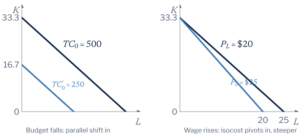
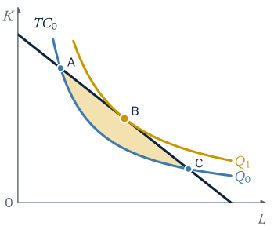
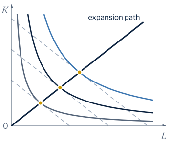
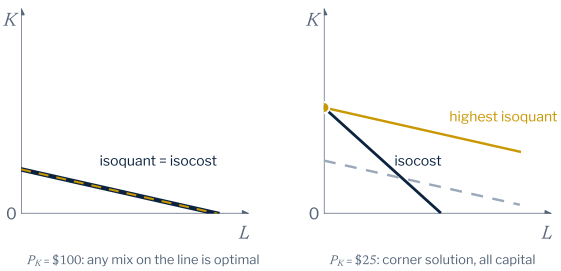

## {.course-title .center background-color="#0C2340" background-image="../theme/title-curves.svg" background-size="cover"}

[Lesson 8]{.lesson-no}

<h1 class="lesson-title">Profit and Revenue Maximization</h1>

::: {.lesson-meta}
FIN 30210 Managerial Economics 
Jason R. Reed, PhD, University of Notre Dame
:::

# Optimal input {.section-break background-color="#0C2340" background-image="../theme/section-grid.svg" background-size="cover"}

## Total cost as an operating budget

- We assume labor and capital are the only inputs in a single-output production process, so total cost is

$$
TC_0 = P_L L + P_K K
$$

- $P_L$ and $P_K$ are the prices of labor and capital
- We can think of the total cost function as the **operating budget**
- If we fix the cost at $TC_0$, the cost equation becomes the **isocost equation**

## The isocost line is the firm's constraint

Think of it as the firm's budget for the week or month. With a \$1,000 budget, a \$100 wage, and a \$150 rental price of capital:

$$
1{,}000 = 100L + 150K
$$

To graph it, solve for $K$ in terms of $L$ (or $L$ in terms of $K$):

$$
K = 6.67 - 0.67L
$$

## The general isocost line

::: {.equation}
$$
K = \frac{TC_0}{P_K} - \left(\frac{P_L}{P_K}\right)L
$$
:::

- The **slope is negative** and the **relationship is linear**
- The slope tells us how much labor can be substituted for a unit of capital while keeping cost the same
- It's set by the ratio of the wage to the rental price of capital

## Moving the isocost line

::: {.figure-wide .short}
{fig-alt="Left: a budget of 500 and a budget of 250 give two parallel isocost lines. Right: raising the wage from 20 to 25 dollars pivots the isocost line in along the labor axis, making it steeper."}
:::

::: {.cols-2}
::: {.col}
[Budget falls from \$500 to \$250]{.h}
With $P_L = 20$ and $P_K = 15$, $K = 33.33 - 1.33L$ becomes $K = 16.67 - 1.33L$: a parallel shift **in**.
:::

::: {.col}
[Wage rises from \$20 to \$25]{.h}
The budget is unchanged and $P_K$ is unchanged, so $K = 33.33 - 1.67L$. The isocost gets steeper, because the same budget buys less labor.
:::
:::

## Shifting the isocost line

::: {.problem}
[Problem 8.1]{.problem-label}
The wage rate is \$25, the price of capital is \$40, and the firm's operating budget is \$2,500.

1. What is the firm's isocost equation, in terms of $K$?
2. What happens as the wage rate decreases?
3. What happens if the rental price of capital increases instead?
4. What happens if the wage and the price of capital fall by the same percentage?
:::

## Problem 8.1: solution

::: {.solution-step .fragment}
[Isocost]{.label}

::: {.v}
$2{,}500 = 25L + 40K \;\Rightarrow\; K = 62.5 - 0.625L$, or equivalently $L = 100 - 1.6K$
:::
:::

::: {.solution-step .fragment}
[Lower wage]{.label}

::: {.v}
The labor intercept $TC_0 / P_L$ grows, so the isocost pivots **out** along the labor axis and gets flatter.
:::
:::

::: {.solution-step .fragment}
[Higher rental price]{.label}

::: {.v}
The capital intercept $TC_0 / P_K$ shrinks, so the isocost pivots **in** along the capital axis and also gets flatter.
:::
:::

::: {.solution-step .fragment}
[Both fall equally]{.label}

::: {.v}
The price ratio $P_L / P_K$ doesn't change, so the slope is the same: a **parallel shift outward**.
:::
:::

## Isoquants and isocosts together

Given an isocost line, there are infinitely many input combinations that make a specific amount of output. It's practical to include the output the firm plans to make, its isoquant, as a constraint too.

::: {.cols-2}
::: {.col}
[Slope of the isoquant]{.h}

$$
\frac{dK}{dL} = -\frac{MP_L}{MP_K} = MRTS_{KL} < 0
$$
:::

::: {.col}
[Slope of the isocost line]{.h}

$$
\frac{dK}{dL} = -\frac{P_L}{P_K} < 0
$$
:::
:::

## Where the isocost touches the isoquant

::: {.split}
{fig-alt="An isocost line crosses isoquant Q0 at points A and C and is tangent to the higher isoquant Q1 at point B. The region between the isocost line and Q0 is shaded."}

::: {.col}
Points A and C are on both the isocost line and the isoquant $Q_0$.

$$
\begin{aligned}
A&: \frac{MP_L}{MP_K} > \frac{P_L}{P_K} \\
C&: \frac{MP_L}{MP_K} < \frac{P_L}{P_K}
\end{aligned}
$$

The shaded area is where the firm can make more output than $Q_0$ for less than $TC_0$. That's better for the firm, so output will increase.
:::
:::

## Reallocating the budget

Cross-multiply and the inequalities compare the **marginal product per dollar** spent on each input:

::: {.eq-grid}
$$
A: \frac{MP_L}{P_L} > \frac{MP_K}{P_K}
$$

$$
C: \frac{MP_L}{P_L} < \frac{MP_K}{P_K}
$$
:::

At point A, a dollar moved from capital to labor raises output. At point C, a dollar moved from labor to capital does. Either way, reallocating produces a net increase in output.

## The optimal input combination

Point B is the only point with no gain from reallocation:

::: {.equation}
$$
B: \frac{MP_L}{P_L} = \frac{MP_K}{P_K}
$$
:::

- The marginal product per dollar spent on labor **equals** the marginal product per dollar spent on capital: the same bang for the buck
- Geometrically, the isocost line is **tangent** to the isoquant

::: {.takeaway}
To minimize total cost for a fixed output, or maximize output for a fixed budget, find where the slope of the isoquant equals the slope of the isocost line.
:::

## Is this firm efficient?

::: {.problem}
[Problem 8.2]{.problem-label}
At the firm's current output, the marginal product of labor is 50 units and the wage is \$25. The marginal product of capital is 100 units and the price of capital is \$40.

1. Can we tell whether the firm has made an efficient (optimal) choice of capital and labor? How?
2. If not, should the firm use more labor or more capital? Why?
:::

## Problem 8.2: solution

::: {.solution-step .fragment}
[Efficiency]{.label}

::: {.v}
Optimal requires $\dfrac{MP_L}{P_L} = \dfrac{MP_K}{P_K}$. Here $\dfrac{50}{25} = 2 < 2.5 = \dfrac{100}{40}$, so the firm isn't efficient.
:::
:::

::: {.solution-step .fragment}
[Advice]{.label}

::: {.v}
Shift spending toward the input with the higher marginal product per dollar: **use more capital and less labor**.
:::
:::

## Pricing inputs at the optimum

::: {.problem}
[Problem 8.3]{.problem-label}
The firm's production function is $Q = 100K^{0.5}L^{0.5}$. It currently has 25 employees and 100 units of capital.

1. If the price of capital is \$20 per unit, what would the price of labor be if resources were allocated optimally?
2. If the price of capital rises to \$25 and nothing else changes, how much capital should the firm use to stay efficient?
:::

## Problem 8.3: solution

::: {.solution-step .fragment}
[Price of labor]{.label}

::: {.v}
Optimality requires $\dfrac{MP_L}{P_L} = \dfrac{MP_K}{P_K}$, and here $\dfrac{MP_L}{MP_K} = \dfrac{50K^{0.5}L^{-0.5}}{50K^{-0.5}L^{0.5}} = \dfrac{K}{L}$, so $P_L = 20\left(\dfrac{100}{25}\right) = \$80$
:::
:::

::: {.solution-step .fragment}
[New capital]{.label}

::: {.v}
$\dfrac{K}{L} = \dfrac{P_L}{P_K} \Rightarrow K = \left(\dfrac{80}{25}\right)(25) = 80$ units
:::
:::

# The expansion path {.section-break background-color="#0C2340" background-image="../theme/section-grid.svg" background-size="cover"}

## The expansion path

::: {.split .text-left}
::: {.col}
- The **expansion path** is the set of points where isocost lines are tangent to isoquants: every point is efficient for the firm
- As budgets and output grow and shrink, it traces the cost-minimizing ratio of inputs
- To find it, start with $\dfrac{MP_L}{P_L} = \dfrac{MP_K}{P_K}$. We know $P_L$ and $P_K$, so solve for $K$ in terms of $L$
:::

{fig-alt="Three parallel isocost lines, each tangent to a higher isoquant. A straight line from the origin through the three tangency points is the expansion path."}
:::

## Finding the expansion path

::: {.problem}
[Problem 8.4]{.problem-label}
The firm's production function is $Q = 30K^{0.7}L^{0.5}$, with $P_L = 20$ and $P_K = 30$. What is the expansion path?
:::

::: {.eq-steps .fragment}
$$
\frac{MP_L}{P_L} = \frac{MP_K}{P_K} \;\Rightarrow\; \frac{30(0.5)K^{0.7}L^{-0.5}}{20} = \frac{30(0.7)K^{-0.3}L^{0.5}}{30}
$$

$$
\frac{K^{0.7}}{K^{-0.3}} = \left(\frac{20}{30}\right)\left(\frac{0.7}{0.5}\right)\left(\frac{L^{0.5}}{L^{-0.5}}\right) \;\Rightarrow\; K = 0.93L
$$
:::

::: {.takeaway .fragment}
$K = 0.93L$ is the equation for the expansion path.
:::

## When inputs are perfect substitutes

::: {.problem}
[Problem 8.5]{.problem-label}
We estimate the production function $Q = 250(L + 4K)$, with $P_L = 25$ and $P_K = 100$.

1. What is the expansion path?
2. If the price of capital falls to \$25, what is the new expansion path?
:::

## Problem 8.5: solution

::: {.solution-step .fragment}
[$P_K = \$100$]{.label}

::: {.v}
$\dfrac{MP_L}{P_L} = \dfrac{250}{25} = 10 = \dfrac{1{,}000}{100} = \dfrac{MP_K}{P_K}$. Marginal products are constant, so **any** combination on the isocost is optimal: the isoquant lies right on top of the isocost line.
:::
:::

::: {.solution-step .fragment}
[$P_K = \$25$]{.label}

::: {.v}
$\dfrac{250}{25} = 10 < 40 = \dfrac{1{,}000}{25}$. Capital *always* gives more per dollar, so the firm uses only capital: a **corner solution**.
:::
:::

## Corner solutions

::: {.figure-wide .short}
{fig-alt="Left: a linear isoquant lying exactly on the isocost line. Right: after capital gets cheaper, the highest reachable linear isoquant touches the isocost only at the capital axis."}
:::

When the isoquant and isocost are both straight lines, they either coincide (every mix is optimal) or meet only at an axis (use one input).

# Maximizing profit {.section-break background-color="#0C2340" background-image="../theme/section-grid.svg" background-size="cover"}

## Unconstrained optimization of profit

**Profit** is the difference between total revenue and total cost:

$$
\pi(Q) = TR(Q) - TC(Q)
$$

Set the first-order condition equal to zero, so **marginal revenue equals marginal cost**. The second-order condition for a maximum is that the second derivative is negative.

::: {.equation}
$$
\frac{d\pi}{dQ} = \frac{dTR}{dQ} - \frac{dTC}{dQ} = 0 \;\Rightarrow\; MR = MC
$$
:::

## Profit maximization in perfect competition

For now, assume prices are set by market forces and firms take them as given, so total revenue is $TR = P_0 Q$. Substitute into the profit equation:

::: {.eq-steps}
$$
\pi = P_0 Q - TC(Q) \qquad \frac{dTR}{dQ} - \frac{dTC}{dQ} = 0 \qquad P_0 = MC
$$
:::

- Firms should choose the quantity where **price equals marginal cost**
  - At that output, total cost is increasing at an increasing rate
  - Marginal profit from any additional unit is zero and falling
- In every other market structure, we'll still solve for the quantity that equates $MR$ and $MC$, then price on the demand curve by plugging in that quantity

## A price taker's output

::: {.problem}
[Problem 8.6]{.problem-label}
Your firm is a price taker and the market price is \$6. You estimate total cost as $TC = 6 + 33Q - Q^3$.

1. What is the total revenue equation?
2. What are MR, MC, and ATC?
3. What is the profit-maximizing level of output?
:::

## Problem 8.6: solution

::: {.solution-step .fragment}
[Revenue and costs]{.label}

::: {.v}
$TR = 6Q$, so $MR = 6$. $MC = 33 - 3Q^2$ and $ATC = 6Q^{-1} + 33 - Q^2$.
:::
:::

::: {.solution-step .fragment}
[First-order condition]{.label}

::: {.v}
$\dfrac{d\pi}{dQ} = 6 - (33 - 3Q^2) = 0 \;\Rightarrow\; 3Q^2 = 27 \;\Rightarrow\; Q = 3$
:::
:::

::: {.solution-step .fragment}
[Second-order condition]{.label}

::: {.v}
$\dfrac{d^2\pi}{dQ^2} = 6Q = 18 > 0$ at $Q = 3$. With this cost function marginal cost *falls* as output rises, so $Q = 3$ is a profit minimum. Always check the second-order condition.
:::
:::

::: notes
As written, TC = 6 + 33Q − Q³ has a downward-sloping marginal cost, so the first-order condition finds a minimum. The intended cost function probably had a rising marginal cost; check the original problem source.
:::

## Maximizing profit over inputs

We can also maximize profit by substituting the production function for output:

$$
\pi(K, L) = P_0 f(K, L) - (P_L L + P_K K)
$$

The first-order conditions are

$$
\frac{\partial \pi}{\partial K} = P_0\left(\frac{\partial Q}{\partial K}\right) - P_K = 0 \qquad \frac{\partial \pi}{\partial L} = P_0\left(\frac{\partial Q}{\partial L}\right) - P_L = 0
$$

Intuitively, each input's **marginal revenue product** equals its **marginal resource cost**: $MRP_i = MRC_i$, where $i$ is capital or labor.

## Solving for the optimal inputs

1. Rearrange each condition: $\dfrac{P_0}{P_K}\left(\dfrac{\partial Q}{\partial K}\right) = 1$ and $\dfrac{P_0}{P_L}\left(\dfrac{\partial Q}{\partial L}\right) = 1$
2. Set them equal: $\dfrac{MP_K}{P_K} = \dfrac{MP_L}{P_L}$
3. Solve for the expansion path
4. Plug the expansion path into the budget constraint

## {.next-up .center background-color="#0C2340" background-image="../theme/section-grid.svg" background-size="cover"}

[Up next: Lesson 9]{.lesson-no}

<h1>Perfect Competition and Monopoly</h1>

::: {.next-links}
[Open Lesson 9](lesson-09.html) [All lessons](../index.html)
:::
