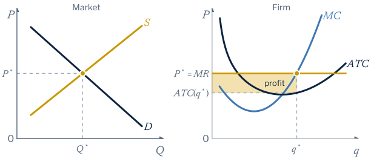
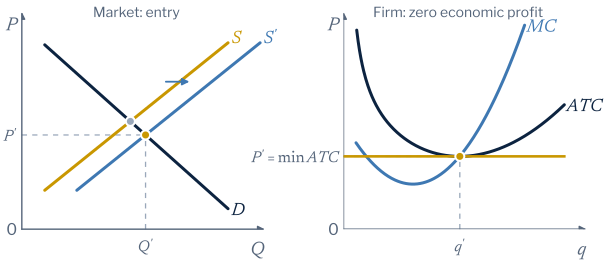
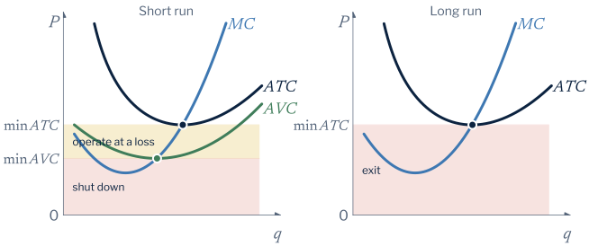
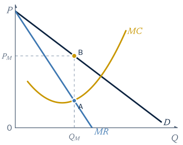
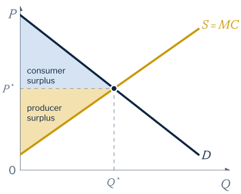
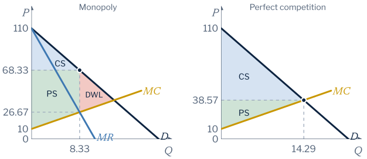

## {.course-title .center background-color="#0C2340" background-image="../theme/title-curves.svg" background-size="cover"}

[Lesson 9]{.lesson-no}

<h1 class="lesson-title">Perfect Competition and Monopoly</h1>

::: {.lesson-meta}
FIN 30210 Managerial Economics 
Jason R. Reed, PhD, University of Notre Dame
:::

## Characterizing a market

Markets run along a spectrum from perfect competition, through monopolistic competition and oligopoly, to monopoly. Four characteristics place a market on it:

::: {.cols-4}
::: {.col}
[Sellers]{.h}
The number and size distribution of sellers
:::

::: {.col}
[Buyers]{.h}
The number and size distribution of buyers
:::

::: {.col}
[Differentiation]{.h}
How different the products are
:::

::: {.col}
[Entry and exit]{.h}
How easily firms enter and leave
:::
:::

## Sellers and buyers

::: {.terms}
::: {.t}
Number and size of sellers
:::

::: {.d}
Directly affects a firm's ability to set price. Many similarly sized firms keep any one firm from controlling price: pricing above or below the market rate could drop sales to zero or fail to maximize profit. An industry with one or a few producers that can satisfy market demand has price flexibility.
:::

::: {.t}
Number and size of buyers
:::

::: {.d}
Many small buyers will likely pay the same price. Buyers of a large share of industry output can extract price concessions.
:::
:::

::: notes
When there's a single buyer, we call the market a monopsony. When there are a few large buyers, it's an oligopsony.
:::

## Differentiation, entry, and exit

::: {.terms}
::: {.t}
Product differentiation
:::

::: {.d}
When products are undifferentiated, consumers choose on price. Differentiation goes with price control: the more differentiated the product, the more control.
:::

::: {.t}
Barriers to entry
:::

::: {.d}
Let existing firms influence output and pricing by keeping newcomers out, through patents or ownership of a unique resource, for example.
:::

::: {.t}
Barriers to exit
:::

::: {.d}
Can prevent resources from moving to other markets. How specialized the resources are dictates how easily they move.
:::
:::

# Perfect competition {.section-break background-color="#0C2340" background-image="../theme/section-grid.svg" background-size="cover"}

## Perfect competition

Firms in a perfectly competitive industry are **price takers** with no market power. The market has

- Many utility-maximizing buyers and profit-maximizing sellers
- A homogeneous good or service
- Perfect mobility of the factors of production
- Buyers and sellers with perfect information about market conditions
- Easy entry into and exit from the industry

::: notes
Market power is a firm's ability to influence the market price of its product by changing its output. A firm that produces a significant share of industry output has market power.

A firm with market power is a price maker. It faces a downward-sloping demand curve, so it can change the market price by changing its output.

A perfectly competitive firm is a price taker because it can't influence the market price of its product.
:::

## The market sets the firm's price

::: {.figure-wide .short}
{fig-alt="Left: market supply and demand set the price P star. Right: the firm takes P star as a horizontal marginal revenue line, produces where it meets MC at q star, and earns the shaded profit between price and ATC."}
:::

Industry supply and demand set the price every firm takes and the industry quantity. Each firm produces where $P^* = MR = MC$.

## Market equilibrium with many firms

::: {.problem}
[Problem 9.1]{.problem-label}
A perfectly competitive industry has 1,000 identical firms. Market demand and supply are

$$
Q_D = 170{,}000{,}000 - 10{,}000{,}000P \qquad Q_S = 70{,}000{,}000 + 15{,}000{,}000P
$$

1. What are the market equilibrium price and quantity?
2. How much does one firm produce in equilibrium?
3. If one firm leaves, what is the new market supply curve? How do the equilibrium price and quantity change?
:::

## Problem 9.1: solution

::: {.solution-step .fragment}
[Equilibrium]{.label}

::: {.v}
$170{,}000{,}000 - 10{,}000{,}000P = 70{,}000{,}000 + 15{,}000{,}000P \Rightarrow P^* = 4$, and $Q^* = 70{,}000{,}000 + 15{,}000{,}000(4) = 130{,}000{,}000$
:::
:::

::: {.solution-step .fragment}
[One firm]{.label}

::: {.v}
$Q^*$ is the sum of all firms' output, so $q^* = 130{,}000{,}000 / 1{,}000 = 130{,}000$
:::
:::

::: {.solution-step .fragment}
[One firm leaves]{.label}

::: {.v}
Each firm supplies $q_s = 70{,}000 + 15{,}000P$, so with 999 firms $Q_S = 69{,}930{,}000 + 14{,}985{,}000P$. Price rises a little and quantity falls a little: $P = 4.0052$ and $Q = 129{,}948{,}000$.
:::
:::

## Short-run profit maximization

Assume the perfectly competitive firm is a **profit maximizer**:

$$
\pi(Q) = TR(Q) - TC(Q) \qquad \frac{d\pi(Q)}{dQ} = \frac{dTR(Q)}{dQ} - \frac{dTC(Q)}{dQ} = 0 \;\Rightarrow\; MR = MC
$$

Total revenue is $TR = P \cdot Q$, and the firm takes $P_0$ as given, so

::: {.equation}
$$
\frac{dTR(Q)}{dQ} = MR = P_0 = MC
$$
:::

- Firms choose the quantity that equates price and marginal cost
- That assumes output is divisible into infinitesimally small units. Otherwise, choose the quantity that gets closest to the equality without going over

## Measuring short-run profit

Mathematically,

$$
\pi = TR - TC = P^* \cdot q^* - ATC(q^*) \cdot q^*
$$

On the graph, profit is the rectangle between price and $ATC(q^*)$, out to $q^*$: total revenue $0P^*Aq^*$ minus total cost $0\,ATC(q^*)\,B\,q^*$.

We don't draw the total cost function, so we rely on average total cost, $ATC = TC/Q$.

## Entry and exit erode profits and losses

- In the short run, firms can earn positive or negative economic profit
- **Entry and exit** erode any profits or losses
  - *Profits attract firms into the industry, increasing market supply and lowering prices: they erode profits*
  - *Losses push firms out of the industry, decreasing market supply and raising prices: they erode losses*
- The changes aren't necessarily instantaneous. Firms can keep operating in the short run until resources can be reallocated

## The long-run break-even point

::: {.figure-wide .short}
{fig-alt="Left: entry shifts market supply to the right and lowers the price to P prime. Right: at P prime the firm's price line touches the bottom of its ATC curve, where MC crosses, so economic profit is zero."}
:::

Firms keep entering and exiting until there's no incentive to do either: the **break-even** point, where $P^* = ATC(q^*)$ and $\pi = 0$.

## The adjustment isn't smooth

This process needn't be smooth or instantaneous.

- Uncertainty and incomplete information can lead firms to miscalculate
- Too many firms could enter the industry, leaving each with a loss:

$$
\pi = TR - TC = q_f\left(P^* - ATC(q_f)\right) < 0
$$

::: {.prompt}
What happens to a firm facing an economic loss? Does it keep producing?
:::

# Losses and shutdown {.section-break background-color="#0C2340" background-image="../theme/section-grid.svg" background-size="cover"}

## Shut down or keep going?

A manager facing an economic loss has two choices:

- Keep producing at a loss and hope prices rebound
- Shut down operations completely

**Shutting down** is a *short-run* decision; **exiting** the industry is a *long-run* one. In the short run at least one resource is fixed, so resources can't be fully reallocated.

## The shutdown point and the exit point

Recall that $ATC = AFC + AVC$.

- A firm whose price is above AVC at its chosen output stays open and minimizes losses, $P^* > AVC$. It can pay for its labor and hopefully some of its fixed capital costs
- The **shutdown** point is where $P < AVC$: the firm closes its doors but doesn't move its assets to another industry
- The **exit** point is where $P < ATC$
- In terms of revenue, shut down when $P \cdot Q < AVC \cdot Q$, that is, when $TR < TVC$

::: notes
Given how we've built the market, both the shutdown point and the exit point happen at the minimums of AVC and ATC.
:::

## Shutdown in the short run, exit in the long run

::: {.figure-wide}
{fig-alt="Left, short run: between the minimum of AVC and the minimum of ATC, the firm operates at a loss; below the minimum of AVC, it shuts down. Right, long run: below the minimum of ATC, the firm exits."}
:::

::: notes
The shutdown price equals the minimum average variable cost. Below it, the firm shuts down, because its loss, which equals total fixed cost, is smaller than if it stayed in business.
:::

## Two qualifications

1. Firms only shut down if they believe prices will stay below AVC for an extended period
   - Some production processes aren't easily stopped and restarted
   - Competitive firms may not actually be closing their doors
2. Firms shut down if they see their time frame as the short run
   - Can the firm do anything to eliminate its fixed costs?

## Finding the shutdown price

::: {.problem}
[Problem 9.2]{.problem-label}
A perfectly competitive firm faces the total cost function $TC = 500 + 150Q - 20Q^2 + Q^3$. Below what price should it shut down?
:::

::: {.eq-steps .fragment}
$$
TVC = 150Q - 20Q^2 + Q^3 \qquad AVC = \frac{TVC}{Q} = 150 - 20Q + Q^2
$$

$$
\frac{dAVC}{dQ} = -20 + 2Q = 0 \;\Rightarrow\; Q = 10 \qquad AVC(10) = 150 - 20(10) + (10)^2 = 50
$$
:::

::: {.takeaway .fragment}
Shut down if $P < \$50$.
:::

## Profit, break-even, and shutdown

::: {.problem}
[Problem 9.3]{.problem-label}
A perfectly competitive firm sells its good for \$10, and its total cost function is $TC = 100 + 2Q + 0.01Q^2$.

1. What is the firm's profit-maximizing output? What is its profit or loss?
2. What is the long-run break-even (exit) price and output?
3. What is the shutdown price and output?
:::

## Problem 9.3: solution

::: {.solution-step .fragment}
[Profit]{.label}

::: {.v}
$\pi = 10Q - (100 + 2Q + 0.01Q^2)$, so $\dfrac{d\pi}{dQ} = 8 - 0.02Q = 0 \Rightarrow Q = 400$, and $\pi = 4{,}000 - 100 - 800 - 1{,}600 = \$1{,}500$
:::
:::

::: {.solution-step .fragment}
[Break-even]{.label}

::: {.v}
$ATC = 100Q^{-1} + 2 + 0.01Q$. Minimize: $-100Q^{-2} + 0.01 = 0 \Rightarrow Q = 100$, and $ATC(100) = 1 + 2 + 1 = \$4$
:::
:::

::: {.solution-step .fragment}
[Shutdown]{.label}

::: {.v}
$AVC = 2 + 0.01Q$ is lowest at $Q = 0$, where $AVC = \$2$
:::
:::

# Monopoly {.section-break background-color="#0C2340" background-image="../theme/section-grid.svg" background-size="cover"}

## Monopoly

::: {.cols-2}
::: {.col}
[A single producer]{.h}
Faces a **downward-sloping demand** curve, because the firm is a price maker. The firm's output is the industry's output.
:::

::: {.col}
[High barriers to entry]{.h}
Resource rights, patents, unique managerial talent, economies of scale, and government franchises.
:::
:::

## Barriers to entry

::: {.terms}
::: {.t}
Resource rights
:::

::: {.d}
Alcoa, an aluminum producer, once owned or controlled nearly all of the world's bauxite deposits. Controlling a vital factor of production lets a firm control production for the whole industry.
:::

::: {.t}
Patent rights
:::

::: {.d}
The exclusive legal right to produce a good or service, which gives an incentive to invest in research and development. *Should patents always exist? In health care?*
:::

::: {.t}
Government franchise
:::

::: {.d}
Public utilities are given monopoly control because it's more efficient for a single firm to produce. Major League Baseball is a legal monopoly exempt from antitrust regulation.
:::
:::

Nearly every barrier to entry depends on creating and enforcing private property laws. That's why reverse engineering is so common where those laws, or their enforcement, don't exist.

## Short-run price and output for a monopolist

::: {.split}
{fig-alt="A downward-sloping demand curve with a steeper marginal revenue curve and a U-shaped MC. MR equals MC at point A, giving quantity Q M; price P M is read off the demand curve at point B."}

::: {.col}
- Firms face downward-sloping demand and U-shaped MC and ATC curves
- Like a competitive firm, the monopolist produces where $MR = MC$ (point A)
- ***The selling price comes from the demand curve*** (point B)
- If barriers to entry were low, entrants would make each firm's demand more elastic, until enough had entered to leave the perfectly elastic demand of perfect competition
:::
:::

## A monopolist's price and quantity

::: {.problem}
[Problem 9.4]{.problem-label}
A monopolist's total cost and demand equations are $TC = 500 + 20Q^2$ and $P = 400 - 20Q$. What are the profit-maximizing price and quantity?
:::

::: {.eq-steps .fragment}
$$
\pi = TR - TC = (400 - 20Q)Q - (500 + 20Q^2)
$$

$$
\frac{d\pi}{dQ} = 400 - 40Q - 40Q = 0 \;\Rightarrow\; 80Q = 400 \;\Rightarrow\; Q^* = 5
$$

$$
P^* = 400 - 20(5) = 300
$$
:::

## Long-run profit for a monopolist

Profits for a monopolist won't be competed away as long as barriers to entry stay high.

::: {.problem}
[Problem 9.5]{.problem-label}
What are the profit-maximizing price, quantity, and profit for a monopolist facing these demand and cost functions?

$$
Q = 3{,}000 - 60P \qquad TC = 100 + 5Q + \tfrac{1}{480}Q^2
$$
:::

## Problem 9.5: solution

Profit has to be written in terms of $Q$ alone, so first invert demand: $\tfrac{1}{60}Q = 50 - P \Rightarrow P = 50 - \tfrac{1}{60}Q$.

::: {.eq-steps}
::: {.fragment}
$$
\pi = \left(50 - \tfrac{1}{60}Q\right)Q - \left(100 + 5Q + \tfrac{1}{480}Q^2\right)
$$
:::

::: {.fragment}
$$
\frac{d\pi}{dQ} = 50 - \tfrac{1}{30}Q - 5 - \tfrac{1}{240}Q = 0 \;\Rightarrow\; 45 = \tfrac{9}{240}Q \;\Rightarrow\; Q^* = 1{,}200
$$
:::

::: {.fragment}
$$
P^* = 50 - \tfrac{1}{60}(1{,}200) = 30 \qquad \pi = (1{,}200)(30) - \left(100 + 5(1{,}200) + \tfrac{1}{480}(1{,}200)^2\right) = 26{,}900
$$
:::
:::

# Monopoly and elasticity {.section-break background-color="#0C2340" background-image="../theme/section-grid.svg" background-size="cover"}

## Bringing in the demand curve

A profit-maximizing monopolist's first-order condition is

$$
\frac{d\pi(Q)}{dQ} = \frac{dTR(Q)}{dQ} - \frac{dTC(Q)}{dQ} = 0
$$

We can rewrite it to include the **demand curve**. Since $TR = P(Q) \cdot Q$,

::: {.eq-steps}
::: {.fragment}
$$
P + Q\left(\frac{dP}{dQ}\right) - MC = 0 \;\Rightarrow\; -Q\left(\frac{dP}{dQ}\right) = P - MC
$$
:::

::: {.fragment}
$$
-\frac{Q}{P}\left(\frac{dP}{dQ}\right) = \frac{P - MC}{P} \;\Rightarrow\; -\frac{1}{\varepsilon_P} = \frac{P - MC}{P}
$$
:::
:::

## Monopolists price on the elastic part of demand

::: {.equation}
$$
-\frac{1}{\varepsilon_P} = \frac{P - MC}{P}
$$
:::

- For a monopolist $P > MC$, so the left-hand side has to be positive
- With $\varepsilon_P < 0$, that requires $\varepsilon_P \le -1$, or $|\varepsilon_P| \ge 1$

::: {.takeaway}
A profit-maximizing monopolist always operates where demand is price elastic.
:::

## The Lerner index

::: {.definition}
[Lerner index]{.term}
$L = \dfrac{P - MC}{P}$, the negative inverse of the price elasticity of demand, and a **measure of monopoly power**.
:::

- It takes values between 0 and 1
- The bigger the gap between price and marginal cost, the bigger the Lerner index, and the greater the monopoly power
- Monopolists choose prices on the elastic portion of the demand curve

## The Lerner index for a competitive firm

::: {.problem}
[Problem 9.6]{.problem-label}
The market price in a perfectly competitive industry is \$10, and an individual firm's total cost equation is $TC = 100 + 6Q + Q^2$. What is the Lerner index?
:::

::: {.eq-steps .fragment}
$$
\pi = 10Q - (100 + 6Q + Q^2) \qquad \frac{d\pi}{dQ} = 10 - 6 - 2Q = 0 \;\Rightarrow\; Q^* = 2
$$

$$
MC^* = 6 + 2(2) = 10 \qquad L = \frac{P - MC}{P} = \frac{10 - 10}{10} = 0
$$
:::

## The Lerner index for a monopolist

::: {.problem}
[Problem 9.7]{.problem-label}
A monopolist faces demand $P = 10 - Q$ and total cost $TC = 100 + 6Q + Q^2$. What is the Lerner index?
:::

::: {.eq-steps .fragment}
$$
\pi = (10 - Q)Q - (100 + 6Q + Q^2) \qquad \frac{d\pi}{dQ} = 10 - 2Q - 6 - 2Q = 0 \;\Rightarrow\; Q^* = 1
$$

$$
P^* = 10 - 1 = 9 \qquad MC^* = 6 + 2(1) = 8 \qquad L = \frac{9 - 8}{9} = \frac{1}{9} = 0.11
$$
:::

::: {.takeaway .fragment}
About 11% of the monopolist's price is markup over marginal cost.
:::

# Comparing the two {.section-break background-color="#0C2340" background-image="../theme/section-grid.svg" background-size="cover"}

## Perfect competition and monopoly side by side

::: {.cols-2}
::: {.col}
[Perfectly competitive firms]{.h}
Produce where $MR = MC$, at a quantity greater than a monopolist's. Price is set where MC meets demand, so $P_{PC} < P_M$. Prices fluctuate as entrants erode profits and exiters reduce losses.
:::

::: {.col}
[Monopolists]{.h}
Produce where $MR = MC$, but extract "rents" by choosing a smaller quantity. They produce on the elastic portion of demand and set price from the demand curve at that quantity. No one enters as long as barriers to entry stay high.
:::
:::

## Monopolists are less efficient

- Competitive firms reach the minimum of ATC in the long run, $P = \min ATC$. Monopolists have no incentive to
- Monopolists *misallocate* society's productive resources: not enough of the product is made
- That matters for government-franchised monopolies

::: {.prompt}
At what price should a government-franchised monopoly operate?
:::

# Welfare {.section-break background-color="#0C2340" background-image="../theme/section-grid.svg" background-size="cover"}

## Consumer and producer surplus

::: {.split}
{fig-alt="Supply and demand crossing at P star and Q star. Consumer surplus is the triangle above price and below demand; producer surplus is the triangle below price and above supply."}

::: {.col}
When we discuss welfare, we mean consumer and producer surplus.

**Consumer surplus** is what consumers were willing to pay minus what they actually pay: the area below demand and above price, out to $Q$.

**Producer surplus** is what producers receive minus the minimum they'd accept: the area above supply (MC) and below price, out to $Q$.
:::
:::

## Who gains and who loses

::: {.cols-2}
::: {.col}
[Perfect competition]{.h}
Maximizes total welfare for consumers and producers. The marginal benefit of consuming equals society's marginal cost of producing. It's the "ideal" market structure because all of society's benefits are captured.
:::

::: {.col}
[Monopoly]{.h}
Consumers are worse off and producers better off: welfare transfers from consumers to producers. Charging higher prices erodes total welfare, so monopoly creates **deadweight loss**.
:::
:::

## Measuring monopoly's welfare cost

::: {.problem}
[Problem 9.8]{.problem-label}
A monopolist faces demand $Q = 22 - 0.20P$ and total cost $TC = 100 + 10Q + Q^2$.

1. What are consumer and producer surplus under the monopolist? What's the deadweight loss?
2. If the monopolist were required to operate at the perfectly competitive outcome, what would CS, PS, and deadweight loss be?
:::

## Problem 9.8: the monopoly outcome

::: {.solution-step .fragment}
[Price and quantity]{.label}

::: {.v}
$P = 110 - 5Q$ and $\dfrac{d\pi}{dQ} = 100 - 12Q = 0$, so $Q^* = 8.33$ and $P^* = 68.33$
:::
:::

::: {.solution-step .fragment}
[Consumer surplus]{.label}

::: {.v}
Area below demand and above price: $\tfrac{1}{2}(110 - 68.33)(8.33) = 173.61$
:::
:::

::: {.solution-step .fragment}
[Producer surplus]{.label}

::: {.v}
$MC = 10 + 2Q$, so $MC(Q^*) = 26.67$. Area below price and above MC: $(68.33 - 26.67)(8.33) + \tfrac{1}{2}(26.67 - 10)(8.33) = 416.67$
:::
:::

::: {.solution-step .fragment}
[Deadweight loss]{.label}

::: {.v}
Competitive output is where $MC = D$: $10 + 2Q = 110 - 5Q \Rightarrow Q_{PC} = 14.29$. $DWL = \tfrac{1}{2}(68.33 - 26.67)(14.29 - 8.33) = 124.01$
:::
:::

## Problem 9.8: the competitive outcome

::: {.figure-wide .short}
{fig-alt="Left, monopoly: consumer surplus above 68.33, producer surplus between price and MC out to 8.33, and a deadweight loss triangle between 8.33 and 14.29. Right, perfect competition: price 38.57 at quantity 14.29, with larger consumer surplus and no deadweight loss."}
:::

::: {.eq-grid .fragment}
$P_{PC} = 110 - 5(14.29) = 38.57$

$CS = \tfrac{1}{2}(110 - 38.57)(14.29) = 510.20$

$PS = \tfrac{1}{2}(38.57 - 10)(14.29) = 204.08$

$DWL = 0$
:::

::: notes
Total surplus is the same either way you count it: under monopoly, 173.61 + 416.67 + 124.01 of deadweight loss = 714.29, which matches the competitive total of 510.20 + 204.08.
:::

## {.next-up .center background-color="#0C2340" background-image="../theme/section-grid.svg" background-size="cover"}

[Up next: Lesson 10]{.lesson-no}

<h1>Monopolistic Competition and Oligopoly</h1>

::: {.next-links}
[Open Lesson 10](lesson-10.html) [All lessons](../index.html)
:::
