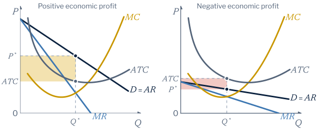
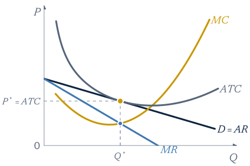
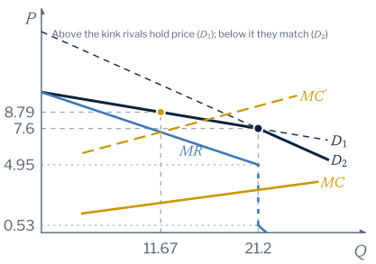
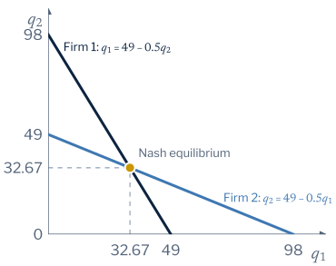

## {.course-title .center background-color="#0C2340" background-image="../theme/title-curves.svg" background-size="cover"}

[Lesson 10]{.lesson-no}

<h1 class="lesson-title">Monopolistic Competition and Oligopoly</h1>

::: {.lesson-meta}
FIN 30210 Managerial Economics 
Jason R. Reed, PhD, University of Notre Dame
:::

# Monopolistic competition {.section-break background-color="#0C2340" background-image="../theme/section-grid.svg" background-size="cover"}

## Between perfect competition and monopoly

On the spectrum of competition, monopolistically competitive (MCP) firms share characteristics of both perfect competition and monopoly.

::: {.terms}
::: {.t}
Sellers
:::

::: {.d}
A large number of firms, each a small percentage of total industry output.
:::

::: {.t}
Buyers
:::

::: {.d}
A large number of buyers. Resources move easily between alternative uses.
:::

::: {.t}
Product differentiation
:::

::: {.d}
Similar but not identical products that consumers see as different enough, such as beer or shoes. They're substitutes, but not perfect ones, which creates **non-price competition**.
:::

::: {.t}
Entry and exit
:::

::: {.d}
Easy entry into and exit from the industry.
:::
:::

::: notes
Non-price competition takes many forms, including advertising, cosmetic differences, and slight fundamental differences.
:::

## Short-run equilibrium

- MCP firms face a **downward-sloping demand curve**: their differentiated product gives them some control over price
- They maximize short-run profit where $MR = MC$, and can earn a profit or take a loss

::: {.figure-wide .short}
{fig-alt="Two panels. Left: price at the profit-maximizing quantity is above ATC, so the firm earns a profit. Right: a weaker demand curve leaves price below ATC, so the firm takes a loss."}
:::

::: notes
The math we developed in the previous lessons will be very useful here.
:::

## Long-run equilibrium

::: {.split .text-left}
::: {.col}
- The firm's objective is to segment the market, and demand tends to be more elastic by the nature of the industry
- Easy entry and exit push long-run economic profit toward zero
- As firms enter, each existing firm's demand curve shifts in and becomes more elastic, until demand is **tangent** to ATC where $MR = MC$

$$
\frac{\pi}{Q^*} = \frac{TR}{Q^*} - \frac{TC}{Q^*} = AR - ATC^* = 0 \;\Rightarrow\; P^* = ATC^*
$$
:::

{fig-alt="A downward-sloping demand curve just touching the ATC curve at the quantity where MR equals MC, so price equals average total cost."}
:::

## Entry wipes out profit

::: {.problem}
[Problem 10.1]{.problem-label}
A typical firm in a monopolistically competitive industry faces demand $Q = 20 - \tfrac{1}{3}P$ and total cost $TC = 100 - 5Q + Q^2$.

1. What are the firm's profit-maximizing price and quantity?
2. A new firm enters, and demand becomes $Q = \tfrac{35}{3} - \tfrac{1}{3}P$. What is the firm's new economic profit?
:::

## Problem 10.1: solution

::: {.solution-step .fragment}
[Before entry]{.label}

::: {.v}
Rewrite demand in terms of $Q$: $P = 60 - 3Q$. Then $\dfrac{d\pi}{dQ} = 60 - 6Q + 5 - 2Q = 0 \Rightarrow Q^* = 8.125$ and $P^* = 60 - 3(8.125) = 35.625$
:::
:::

::: {.solution-step .fragment}
[After entry]{.label}

::: {.v}
$P = 35 - 3Q$, so $\dfrac{d\pi}{dQ} = 35 - 6Q + 5 - 2Q = 0 \Rightarrow Q^* = 5$, and $\pi = (35 - 15)(5) - (100 - 25 + 25) = 0$
:::
:::

::: {.takeaway .fragment}
One entrant is enough to push economic profit to zero.
:::

## Advertising

- Non-price competition matters a lot to MCP firms: think [Nike](https://www.youtube.com/watch?v=VEX7KhIA3bU) and [Adidas](https://www.youtube.com/watch?v=QypkBliIEe4)
- More advertising raises a firm's ATC and MC
  - The firm hopes the increase in demand more than offsets the cost and raises profit
- The optimal level of advertising gives a familiar answer: the firm maximizes profit from advertising by producing where marginal production cost equals marginal revenue

::: notes
Graph: advertising moves MC and ATC from MC₀, ATC₀ to MC₁, ATC₁, and demand from D₀ to D₁. In the example, profit went up.
:::

## Evaluating monopolistic competition

- Deadweight loss still exists in MCP industries
  - Industry output is higher and prices lower than under monopoly, but not on par with perfect competition
  - Firms don't produce at the minimum of ATC in the long run, but at an inefficient output level
- Easy entry and exit encourage product innovation and development
  - Unlike monopolies, where that incentive disappears (Peter Thiel argues otherwise)
  - Consumers get a wider variety of goods and services

# Duopoly and oligopoly {.section-break background-color="#0C2340" background-image="../theme/section-grid.svg" background-size="cover"}

## Characteristics of duopoly and oligopoly

::: {.terms}
::: {.t}
Sellers
:::

::: {.d}
Generally a few firms (2 to 8) controlling roughly 75% or more of a market, with strategic interaction between them.
:::

::: {.t}
Buyers
:::

::: {.d}
Unspecified, but assumed to be large in number.
:::

::: {.t}
Product differentiation
:::

::: {.d}
Products can be homogeneous (steel, copper) or differentiated (automobiles, televisions).
:::

::: {.t}
Entry and exit
:::

::: {.d}
Keeping a duopoly or oligopoly in the long run takes some barrier to entry, much like the ones monopolists enjoy.
:::
:::

## Why oligopolies exist, and how they're policed

- In reality, what creates a duopoly or oligopoly varies by industry and by firm. What we can observe is that they exist
- Antitrust law was written to prevent rent-seeking behavior: the Sherman Act, the Clayton Act, and the Celler-Kefauver Act

# Measuring concentration {.section-break background-color="#0C2340" background-image="../theme/section-grid.svg" background-size="cover"}

## Concentration ratios and the HHI

Concentration measures give the Department of Justice a way to identify and act on monopolistic behavior.

::: {.cols-2}
::: {.col}
[Concentration ratio]{.h}
The share of total industry revenue, or market share, held by the top **four** or **eight** firms. It gives no extra weight to large firms, which can mislead.
:::

::: {.col}
[Herfindahl-Hirschman Index]{.h}
The sum of the squared market shares of the firms in the industry:

$$
HHI = \sum_{i=1}^{n} S_i^2
$$

$S_i$ is firm $i$'s market share in percentage points, so the index runs from near 0 to 10,000.
:::
:::

The HHI is better than a concentration ratio because it gives more weight to firms with larger market shares.

## How regulators read the HHI

::: {.cols-2}
::: {.col}
[2010 Horizontal Merger Guidelines]{.h}
Unconcentrated below 1,500; moderately concentrated from 1,500 to 2,500; highly concentrated above 2,500. A change of more than 100 points often drew scrutiny.
:::

::: {.col}
[2023 Merger Guidelines]{.h}
A merger is presumed to lessen competition if the post-merger HHI is above 1,800 with an increase of more than 100, or if the merged firm's share is above 30% with an increase of more than 100.
:::
:::

[The FTC and DOJ kept the 2023 Merger Guidelines in effect in February 2025.]{.small}

## Concentration in the US auto market

::: {.problem}
[Problem 10.2]{.problem-label}
Using 2017 US auto market shares, find the 4-firm and 8-firm concentration ratios and the HHI. Would the DOJ investigate a GM and Ford merger?
:::

::: {.compact}

| Firm | Share | Firm | Share | Firm | Share |
|:---|---:|:---|---:|:---|---:|
| GM | 16.5% | Mazda | 1.6% | Audi | 1.2% |
| Ford | 15.1% | Mitsubishi | 0.8% | BMW | 2.0% |
| Chrysler | 12.0% | Kia | 3.2% | Porsche | 0.3% |
| Toyota | 13.8% | Subaru | 3.5% | Fiat | 0.2% |
| Honda | 8.8% | Mercedes | 2.1% | Tesla | 0.3% |
| Nissan | 10.9% | Volvo | 0.3% | Jaguar Land Rover | 0.8% |
| Hyundai | 4.5% | Volkswagen | 1.8% | Alfa Romeo | 0.3% |

:::

## Problem 10.2: solution

::: {.solution-step .fragment}
[Concentration ratios]{.label}

::: {.v}
4-firm: $16.5 + 15.1 + 13.8 + 12.0 = 57.4\%$. 8-firm: $57.4 + 10.9 + 8.8 + 4.5 + 3.5 = 85.1\%$
:::
:::

::: {.solution-step .fragment}
[HHI]{.label}

::: {.v}
$16.5^2 + 15.1^2 + 13.8^2 + \cdots + 0.3^2 = 1{,}091$
:::
:::

::: {.solution-step .fragment}
[GM and Ford merge]{.label}

::: {.v}
The merged share is 31.6%, so $HHI = 31.6^2 + 13.8^2 + \cdots = 1{,}589$, an increase of $2(16.5)(15.1) = 498$ points. The market moves from unconcentrated to moderately concentrated, and the merged firm tops 30% with an increase over 100.
:::
:::

::: {.takeaway .fragment}
Yes, most likely. An increase that large is a red flag under either set of guidelines.
:::

::: notes
Market shares are from the Wall Street Journal's 2017 auto sales data.

The original slides computed HHI = 1,090.72 and 1,589.02 after the merger; the shares in the table sum to 1,091.02 and 1,589.32. The increase from the merger is 2 × 16.5 × 15.1 = 498.3, not 100.
:::

# Models of oligopoly {.section-break background-color="#0C2340" background-image="../theme/section-grid.svg" background-size="cover"}

## Kinked demand

The **kinked demand** model tries to explain the price rigidity seen in some oligopolies. The oligopolist actually faces two demand curves.

::: {.cols-2}
::: {.col}
[Firm 1 raises its price above $P^*$]{.h}
If rivals **follow suit**, all firms may or may not be better off. If rivals **hold prices**, Firm 1 is worse off and loses market share. *Demand is more elastic, because competitors held their lower prices.*
:::

::: {.col}
[Firm 1 cuts its price below $P^*$]{.h}
If rivals **follow suit**, all firms lower prices rather than cede market share. *Demand is more inelastic, because competitors cut prices too.* If rivals **hold prices**, they sell to no one.
:::
:::

## Why prices stick

::: {.split}
{fig-alt="Kinked demand at a price of 7.6 and quantity of 21.2: the flatter demand curve D1 applies above the kink and the steeper D2 below it. Marginal revenue jumps from 4.95 down to 0.53 at the kink, and marginal cost MC passes through the gap. A higher marginal cost MC prime crosses MR above the gap, at a quantity of 11.67 and price of 8.79."}

::: {.col}
- Marginal revenue has a **discontinuity** at the kink
- Any MC passing through the gap gives the same quantity and price
- Firms have less incentive to cut costs, and input-price increases may not be passed on
- But the model doesn't explain where $P^*$ comes from, and firms almost always match both price increases and cuts
:::
:::

## Pricing on a kinked demand curve

::: {.problem}
[Problem 10.3]{.problem-label}
An oligopolist faces the two demand curves $Q_1 = 82 - 8P$ and $Q_2 = 44 - 3P$, and total cost $TC = 8 + Q + 0.05Q^2$.

1. Using the kinked demand model, what are the price and quantity for your product?
2. What range of values can marginal cost take before behavior changes?
3. If total cost becomes $TC = 12 + 5Q + 0.1Q^2$, what are the new quantity and price?
:::

## Problem 10.3: solution

::: {.solution-step .fragment}
[The kink]{.label}

::: {.v}
Set the demands equal: $82 - 8P = 44 - 3P \Rightarrow P^* = 7.6$ and $Q^* = 21.2$. Here $MC = 1 + 0.1(21.2) = 3.12$, inside the gap.
:::
:::

::: {.solution-step .fragment}
[The gap in MR]{.label}

::: {.v}
$P = 10.25 - \tfrac{1}{8}Q_1$ gives $MR_1 = 10.25 - \tfrac{1}{4}Q$; $P = 14.67 - \tfrac{1}{3}Q_2$ gives $MR_2 = 14.67 - \tfrac{2}{3}Q$. At $Q^* = 21.2$, MC can run from **0.53 to 4.95**.
:::
:::

::: {.solution-step .fragment}
[New costs]{.label}

::: {.v}
$MC = 5 + 0.2(21.2) = 9.24$ is above the gap, so use $MR_1$: $10.25 - 0.25Q = 5 + 0.2Q \Rightarrow Q = 11.67$ and $P = 8.79$
:::
:::

# The Cournot model {.section-break background-color="#0C2340" background-image="../theme/section-grid.svg" background-size="cover"}

## The Cournot model

- This is the beginning of our introduction to game theory: firms trying to maximize profit are interdependent
- In the **Cournot model**, firms ***choose quantity*** to maximize profit, assuming the rival won't change its output in response
- We assume linear industry demand that the firms share:

$$
P = a - b(q_1 + q_2)
$$

- Each firm writes its profit using the quantity it expects from its rival:

$$
\pi_1(q_1, q_2) = q_1\big(a - b(q_1 + q_2)\big) - TC(q_1) \qquad \pi_2(q_1, q_2) = q_2\big(a - b(q_1 + q_2)\big) - TC(q_2)
$$

## Reaction functions and Nash equilibrium

With constant marginal cost $c$, each firm's first-order condition gives its **reaction function**: the quantity that maximizes its profit given the rival's choice.

$$
\frac{\partial \pi_1}{\partial q_1} = a - 2bq_1 - bq_2 - c = 0 \;\Rightarrow\; q_1 = \frac{a - c}{2b} - \frac{1}{2}q_2 \qquad\quad q_2 = \frac{a - c}{2b} - \frac{1}{2}q_1
$$

- Graphing them shows how the firms "react" to each other
- Where they cross is a **Nash equilibrium**
  - Total industry output is the sum of the firms' outputs
  - Neither firm wants to deviate, because deviating would lower its profit

::: notes
The original slides wrote the reaction functions as q₂ = a₁ − 2b₁q₁ and q₁ = a₂ − 2b₂q₂ and labeled the steeper line as Firm 2's. Solving Firm 1's first-order condition gives q₂ in terms of q₁ only as a rearrangement of Firm 1's own best response; the reaction functions here are the standard form.
:::

## Solving a Cournot model

Suppose $P = 120 - 3Q$, with $Q = Q_1 + Q_2$, and each firm's cost is $TC = 12Q_i$.

::: {.eq-steps}
::: {.fragment}
$$
\pi_1 = \big(120 - 3(Q_1 + Q_2)\big)Q_1 - 12Q_1 \qquad \frac{\partial \pi_1}{\partial Q_1} = 120 - 6Q_1 - 3Q_2 - 12 = 0
$$
:::

::: {.fragment}
$$
Q_1 = 18 - \tfrac{1}{2}Q_2 \qquad Q_2 = 18 - \tfrac{1}{2}Q_1
$$
:::

::: {.fragment}
$$
Q_1 = 18 - \tfrac{1}{2}\left(18 - \tfrac{1}{2}Q_1\right) = 9 + \tfrac{1}{4}Q_1 \;\Rightarrow\; Q_1^* = 12, \quad Q_2^* = 12
$$
:::
:::

## A Cournot duopoly

::: {.split .text-left}
::: {.col}
::: {.problem}
[Problem 10.4]{.problem-label}
Two duopolists face industry demand $P = 200 - 2Q$, and each has $TC = 4Q$. What are each firm's equilibrium price and quantity under Cournot?
:::

::: {.eq-steps .fragment}
$\pi_1 = 196Q_1 - 2Q_1^2 - 2Q_1 Q_2$

$\dfrac{\partial \pi_1}{\partial Q_1} = 196 - 4Q_1 - 2Q_2 = 0 \Rightarrow Q_1 = 49 - \tfrac{1}{2}Q_2$

By symmetry $Q_1^* = Q_2^* = 32.67$

$P = 200 - 2(65.33) = 69.33$
:::
:::

::: {.fragment}
{fig-alt="Two reaction functions: Firm 1's runs from 98 on the q2 axis to 49 on the q1 axis, and Firm 2's from 49 on the q2 axis to 98 on the q1 axis. They cross at 32.67 each, the Nash equilibrium."}
:::
:::

# The Bertrand model {.section-break background-color="#0C2340" background-image="../theme/section-grid.svg" background-size="cover"}

## The Bertrand model

The **Bertrand model** assumes firms ***choose price***, and quantity follows from the price decisions. Each firm faces its own demand curve, rather than sharing industry demand as in Cournot:

$$
Q_1 = f_1(P_1, P_2^e) \qquad Q_2 = f_2(P_1^e, P_2)
$$

$$
\pi_1 = P_1 f_1(P_1, P_2^e) - TC_1(P_1, P_2^e) \qquad \pi_2 = P_2 f_2(P_1^e, P_2) - TC_2(P_1^e, P_2)
$$

To solve, write profit in terms of **prices**, not quantities; differentiate each firm's profit with respect to *its own price*; solve for each reaction function ($P_1$ in terms of $P_2$, and $P_2$ in terms of $P_1$); then solve the system.

## A Bertrand duopoly

::: {.problem}
[Problem 10.5]{.problem-label}
Two duopolists face demand $Q_1 = 50 - 0.5P_1 + 0.25P_2$ and $Q_2 = 50 - 0.5P_2 + 0.25P_1$, and each has $TC = 4Q$. What are each firm's equilibrium price and quantity under Bertrand?
:::

::: {.eq-steps .fragment}
$$
\pi_1 = P_1(50 - 0.5P_1 + 0.25P_2) - 4(50 - 0.5P_1 + 0.25P_2) \qquad \frac{\partial \pi_1}{\partial P_1} = 50 - P_1 + 0.25P_2 + 2 = 0
$$

$$
P_1 = 52 + 0.25P_2 \qquad P_2 = 52 + 0.25P_1 \;\Rightarrow\; P_2 = 65 + 0.0625P_2 \;\Rightarrow\; P_1^* = P_2^* = 69.33
$$

$$
Q_1 = Q_2 = 50 - 0.5(69.33) + 0.25(69.33) = 32.67, \quad Q = 65.33
$$
:::

# Stackelberg and collusion {.section-break background-color="#0C2340" background-image="../theme/section-grid.svg" background-size="cover"}

## The Stackelberg model of quantity leadership

The **Stackelberg model** has a leader and a follower in quantity decisions. The leader is rewarded by capturing more of the market early.

- Empirical tests of this have failed: there's no conclusive evidence that leading an industry maximizes profit in the long run
- Cost differences will be an important driver of a successful first mover

Firm 2, the leader, believes Firm 1 will behave exactly as in the Cournot model. It exploits that by building Firm 1's reaction function into its own profit-maximizing choice.

## Solving a Stackelberg model

Demand is $P = 200 - 2(q_1 + q_2)$, and $TC_1 = 4q_1$, $TC_2 = 4q_2$.

::: {.solution-step .fragment}
[Follower's reaction]{.label}

::: {.v}
$\dfrac{\partial \pi_1}{\partial q_1} = 200 - 4q_1 - 2q_2 - 4 = 0 \Rightarrow q_1 = 49 - \tfrac{1}{2}q_2$
:::
:::

::: {.solution-step .fragment}
[Leader's choice]{.label}

::: {.v}
$\pi_2 = 196q_2 - 2q_2^2 - 2\left(49 - \tfrac{1}{2}q_2\right)q_2 = 98q_2 - q_2^2$, so $\dfrac{d\pi_2}{dq_2} = 98 - 2q_2 = 0 \Rightarrow q_2^* = 49$
:::
:::

::: {.solution-step .fragment}
[Outcome]{.label}

::: {.v}
$q_1^* = 49 - \tfrac{1}{2}(49) = 24.5$, $Q^* = 73.5$, and $P = 200 - 2(73.5) = 53$
:::
:::

## Collusion

When firms recognize their interdependence and agree to **coordinate output** to maximize industry profit:

- Explicit price fixing through price leadership, or agreed quantity limits, as with OPEC
- A formal, explicit agreement is a **cartel**, such as OPEC
- **Tacit collusion** happens when firms avoid price wars, settling on an outcome without saying so

Collusive agreements and cartels are hard to maintain: contracts are hard to enforce, so each member has an incentive to cheat. They're also highly illegal.

## Solving for the collusive outcome

Industry profit is the sum of the firms' profits. With the same demand and costs:

$$
\pi = \pi_1 + \pi_2 = 196q_1 + 196q_2 - 2q_1^2 - 2q_2^2 - 4q_1 q_2
$$

::: {.eq-steps .fragment}
$$
\frac{\partial \pi}{\partial q_1} = 196 - 4q_1 - 4q_2 = 0 \qquad \frac{\partial \pi}{\partial q_2} = 196 - 4q_2 - 4q_1 = 0 \;\Rightarrow\; q_1 + q_2 = 49
$$
:::

::: {.fragment}
Splitting output equally gives $q_1^* = q_2^* = 24.5$, but a prior agreement could split it differently: $q_1^* = 2q_2^*$ gives $q_1^* = 32.67$ and $q_2^* = 16.33$. Price is $P^* = 200 - 2(49) = \$102$.
:::

## Comparing the models

With demand $P = 200 - 2Q$ and $MC = 4$ for each firm:

::: {.compact}

| Model | Firm 1 | Firm 2 | Industry output | Price | Industry profit |
|:---|---:|---:|---:|---:|---:|
| Cournot | 32.67 | 32.67 | 65.33 | \$69.33 | \$4,268 |
| Stackelberg (Firm 2 leads) | 24.5 | 49 | 73.5 | \$53 | \$3,602 |
| Collusion | 24.5 | 24.5 | 49 | \$102 | \$4,802 |

:::

- Stackelberg gives the **highest output** and **lowest price**, and the leader earns more (\$2,401) than a Cournot firm (\$2,134)
- Collusion gives the **highest industry profit**: the firms act together to monopolize the market

[The Bertrand example used a different, differentiated-demand setup, so it isn't directly comparable.]{.small}

## {.next-up .center background-color="#0C2340" background-image="../theme/section-grid.svg" background-size="cover"}

[Up next: Lesson 11]{.lesson-no}

<h1>Introduction to Game Theory</h1>

::: {.next-links}
[Open Lesson 11](lesson-11.html) [All lessons](../index.html)
:::
