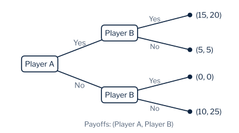
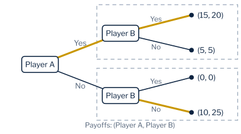
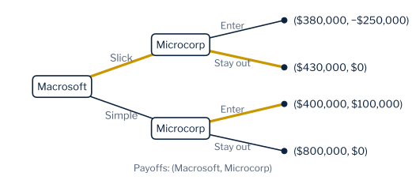

## {.course-title .center background-color="#0C2340" background-image="../theme/title-curves.svg" background-size="cover"}

[Lesson 11]{.lesson-no}

<h1 class="lesson-title">Introduction to Game Theory</h1>

::: {.lesson-meta}
FIN 30210 Managerial Economics<br>
Jason R. Reed, PhD, University of Notre Dame
:::

## The elements of a game

::: {.terms}
::: {.t}
Players
:::

::: {.d}
Firms or individuals who maximize profit or utility. The analysis can change if players are risk loving rather than risk averse.
:::

::: {.t}
Actions (strategies)
:::

::: {.d}
Players choose an action in a one-shot game, or a set of strategies in a repeated game: $S = \{\text{Rock}\}$ or $S = \{\text{Rock, Paper}\}$.
:::

::: {.t}
Payoffs
:::

::: {.d}
Profit, money, utility, prison time, winning the game, getting the phone number. The expected value is $E(x) = \sum_{i=1}^{n} x_i p_i$, where $p_i$ is the probability that $x_i$ occurs. In a **zero-sum** game, one player wins exactly what the other loses.
:::
:::

## Kinds of games

::: {.cols-2}
::: {.col}
[Simultaneous games]{.h}
Players choose strategies at the same time, with full information about the payoffs: war (the card game), rock-paper-scissors, chicken.
:::

::: {.col}
[Sequential games]{.h}
Players take turns choosing strategies, with full information about the payoffs: chess, checkers, Monopoly.
:::

::: {.col}
[One-shot games]{.h}
Simultaneous or sequential, but played only once. Don't confuse this with a single strategy or action.
:::

::: {.col}
[Repeated games]{.h}
Simultaneous or sequential, but played more than once. Running a business is more like a mix of simultaneous and sequential repeated games.
:::
:::

## Dominant strategies and Nash equilibrium

::: {.definition}
[Strictly dominant strategy]{.term}
A strategy whose payoff is always better, whatever the opponent chooses. For example: always telling your spouse they look beautiful.
:::

::: {.definition}
[Nash equilibrium (NE)]{.term}
An outcome where no player can improve their payoff by switching strategies.
:::

- We believe players seek this outcome, so anticipated behavior becomes actual behavior
- A game can have one Nash equilibrium, several, or none

# The prisoners' dilemma {.section-break background-color="#0C2340" background-image="../theme/section-grid.svg" background-size="cover"}

## Split or steal?

[Watch the clip](https://youtu.be/S0qjK3TWZE8) from the game show *Golden Balls*.

- Abraham and Nick each choose **split** or **steal**, and the payoff is a non-trivial amount of cash
  - If both split, they split the winnings
  - If one splits and the other steals, the stealer gets everything
  - If both steal, both get nothing
- They've cooperated in earlier rounds, but this is the final round: essentially a one-shot game
- We can represent the situation as a **payoff matrix**, or normal-form game

## The payoff matrix

A payoff matrix has three parts: players, actions, and payoffs.

```{=html}
<table class="payoff">
<thead><tr><th class="corner">Abraham \ Nick</th><th>Split</th><th>Steal</th></tr></thead><tbody>
<tr><th>Split</th><td>6,800; 6,800</td><td>0; 13,600</td></tr>
<tr><th>Steal</th><td>13,600; 0</td><td>0; 0</td></tr>
</tbody></table>
```

[Payoffs in dollars: (Abraham; Nick).]{.matrix-caption}

::: {.fragment}
- If Nick splits, Abraham's best response is to steal: 13,600 beats 6,800
- If Nick steals, Abraham gets 0 either way
- The same holds for Nick, so **steal is weakly dominant**: never worse and sometimes better
:::

## Snitch or stay quiet?

Two men are caught breaking into a store and held separately for interrogation. Each can **snitch** or **stay quiet**.

- If one snitches and the other stays quiet, the quiet one gets 5 years and the snitch goes free
- If both snitch, each gets 3 years
- If both stay quiet, each gets 1 year on trumped-up charges

Each player has beliefs about what the other will do but doesn't actually know, and must decide what to do in each case.

::: {.prompt}
Set up the payoff matrix. What is the Nash equilibrium?
:::

## Solving the prisoners' dilemma

::: {.split .text-left}
::: {.col}
```{=html}
<table class="payoff">
<thead><tr><th class="corner">P1 \ P2</th><th>Stay quiet</th><th>Snitch</th></tr></thead><tbody>
<tr><th>Stay quiet</th><td class="joint">−1, −1</td><td>−5, 0</td></tr>
<tr><th>Snitch</th><td>0, −5</td><td class="ne">−3, −3</td></tr>
</tbody></table>
```

::: {.legend-key}
[]{.swatch}Nash equilibrium [ ]{.swatch .joint}Joint best outcome
:::
:::

::: {.col .fragment}
[Rows are Prisoner 1, columns Prisoner 2.]{.matrix-caption}

- Snitching is a **strictly dominant strategy**: 0 years beats 1, and 3 beats 5
- So both snitch and each serves 3 years
- Both would be better off staying quiet, but neither can trust the other not to snitch

[Payoffs are years in prison, shown as negatives.]{.small}
:::
:::

# Repeated games {.section-break background-color="#0C2340" background-image="../theme/section-grid.svg" background-size="cover"}

## Repeated games

- For firms, competition is an ongoing, repeated process
  - **Infinitely** repeated games: governments, maybe
  - **Finitely** repeated games: competition has an end, even if firms don't know exactly when. Coca-Cola and Pepsi play a tacit pricing game week after week
- Repeated play lets cooperative strategies evolve
  - **Grim trigger:** cooperate until a rival cheats, then punish immediately and forever
  - **Trembling hand trigger:** like grim trigger, but a cheater gets one grace period to resume cooperating before punishment
- These strategies can support equilibria that couldn't happen in a one-shot game

::: {.takeaway}
In the last round of a repeated game, there's no more reason to cooperate. Each player knows it, and deviates to the equilibrium that's best for them.
:::

## A two-stage game

::: {.split .text-left}
::: {.col}
Two players choose Left or Right, twice. Payoffs are profit in millions of dollars.

With a grim trigger strategy, we need the one-shot Nash equilibrium (where to punish) and the cooperative outcome that *isn't* a Nash equilibrium.
:::

::: {.col}
```{=html}
<table class="payoff">
<thead><tr><th class="corner">P1 \ P2</th><th>Left</th><th>Right</th></tr></thead><tbody>
<tr><th>Left</th><td>10, 10</td><td>12, 9</td></tr>
<tr><th>Right</th><td>9, 12</td><td>11, 11</td></tr>
</tbody></table>
```

[The same matrix is played in Game 1 and Game 2. Payoffs: (Player 1, Player 2).]{.matrix-caption}
:::
:::

::: {.prompt}
What is the Nash equilibrium of each game? What outcome maximizes joint profit?
:::

## The one-shot answer

```{=html}
<table class="payoff">
<thead><tr><th class="corner">P1 \ P2</th><th>Left</th><th>Right</th></tr></thead><tbody>
<tr><th>Left</th><td class="ne">10, 10</td><td>12, 9</td></tr>
<tr><th>Right</th><td>9, 12</td><td class="joint">11, 11</td></tr>
</tbody></table>
```

::: {.legend-key}
[]{.swatch}Nash equilibrium [ ]{.swatch .joint}Joint-profit maximum
:::

- (Left, Left) is the Nash equilibrium of each one-shot game: 10 each
- (Right, Right) maximizes joint profit at 11 each, but each player gains by switching to Left

## Backward induction

By **backward induction**, looking at the last game first, a player can make the best Game 1 choice.

- The last game has to end at a Nash equilibrium: in the final round there's no need to keep building trust, so each player would deviate from (Right, Right)
- So add Game 2's equilibrium payoff, (10, 10), to every cell of Game 1

::: {.split .text-left}
::: {.col}
```{=html}
<table class="payoff">
<thead><tr><th class="corner">P1 \ P2</th><th>Left</th><th>Right</th></tr></thead><tbody>
<tr><th>Left</th><td class="ne">20, 20</td><td>22, 19</td></tr>
<tr><th>Right</th><td>19, 22</td><td class="joint">21, 21</td></tr>
</tbody></table>
```

[Combined Game 1 and Game 2 payoffs.]{.matrix-caption}
:::

::: {.fragment}
The Nash equilibrium is still (Left, Left). To change the outcome, change the payoffs: create an incentive to cooperate.
:::
:::

## A bonus for cooperating

Suppose both players earn a bonus of 2 at the end if they cooperate in Game 1 by choosing Right.

```{=html}
<table class="payoff">
<thead><tr><th class="corner">P1 \ P2</th><th>Left</th><th>Right</th></tr></thead><tbody>
<tr><th>Left</th><td class="ne">20, 20</td><td>22, 19</td></tr>
<tr><th>Right</th><td>19, 22</td><td class="ne">23, 23</td></tr>
</tbody></table>
```

::: {.takeaway .fragment}
The bonus is enough to create a new Nash equilibrium at (Right, Right): neither player gains by switching.
:::

## A three-action game

Now each player chooses Left, Middle, or Right, again over two stages. Payoffs are profit in millions.

::: {.split .text-left}
```{=html}
<table class="payoff">
<thead><tr><th class="corner">P1 \ P2</th><th>L(2)</th><th>M(2)</th><th>R(2)</th></tr></thead><tbody>
<tr><th>L(1)</th><td>1, 1</td><td>5, 0</td><td>0, 0</td></tr>
<tr><th>M(1)</th><td>0, 5</td><td>4, 4</td><td>0, 0</td></tr>
<tr><th>R(1)</th><td>0, 0</td><td>0, 0</td><td>3, 3</td></tr>
</tbody></table>
```

::: {.col}
- First find the one-shot Nash equilibria: we need to know where to cooperate and where to punish
- Then find the outcome we'd like to reach through cooperation that isn't a Nash equilibrium
:::
:::

## Two equilibria, one cooperative outcome

```{=html}
<table class="payoff">
<thead><tr><th class="corner">P1 \ P2</th><th>L(2)</th><th>M(2)</th><th>R(2)</th></tr></thead><tbody>
<tr><th>L(1)</th><td class="ne">1, 1</td><td>5, 0</td><td>0, 0</td></tr>
<tr><th>M(1)</th><td>0, 5</td><td class="joint">4, 4</td><td>0, 0</td></tr>
<tr><th>R(1)</th><td>0, 0</td><td>0, 0</td><td class="ne">3, 3</td></tr>
</tbody></table>
```

::: {.legend-key}
[]{.swatch}Nash equilibrium [ ]{.swatch .joint}Cooperative target
:::

- The two one-shot Nash equilibria are $\{L(1), L(2)\}$ and $\{R(1), R(2)\}$
- The goal: is cooperating in Game 1, and being rewarded in Game 2, more profitable than cheating in Game 1 and being punished in Game 2?
- Check every option for cheating and cooperating. If cooperating pays more, the threat is credible, and cooperating in Game 1 is a Nash equilibrium of the repeated game

## Checking cheating against cooperating

The strategy: if both play Middle in Game 1, reward each other with $(R, R)$ in Game 2. If anyone cheats, punish with $(L, L)$.

::: {.cols-2}
::: {.col}
[Player 1, when Player 2 plays M(2)]{.h}
Deviating to L(1) earns 5 in Game 1, then the punishment L(1) earns 1: **6 in total**.

Cooperating with M(1) earns 4, then the reward R(1) earns 3: **7 in total**.
:::

::: {.col}
[Player 2, when Player 1 plays M(1)]{.h}
Deviating to L(2) earns 5, then the punishment L(2) earns 1: **6 in total**.

Cooperating with M(2) earns 4, then the reward R(2) earns 3: **7 in total**.
:::
:::

## The combined game

::: {.split}
```{=html}
<table class="payoff">
<thead><tr><th class="corner">P1 \ P2</th><th>L(2)</th><th>M(2)</th><th>R(2)</th></tr></thead><tbody>
<tr><th>L(1)</th><td class="ne">2, 2</td><td>6, 1</td><td>1, 1</td></tr>
<tr><th>M(1)</th><td>1, 6</td><td class="ne">7, 7</td><td>1, 1</td></tr>
<tr><th>R(1)</th><td>1, 1</td><td>1, 1</td><td class="ne">4, 4</td></tr>
</tbody></table>
```

::: {.col}
- Add each cell's Game 2 payoff: 3 after mutual cooperation, 1 after anything else
- Players can still choose the original two Nash equilibria
- And they can now choose $\{M(1), M(2)\}$ by cooperating in the first game
- This is **end-game reasoning**, or backward induction
:::
:::

## What repeated games teach us

- In the one-shot prisoners' dilemma, the incentive to cheat sank the mutually beneficial outcome. That wasn't true in the two-stage game
- Credible threats or promises about future behavior can change current behavior
- Backward induction is an important method for solving games with this structure

## Try it: the centipede game

Play a repeated, sequential game in class on the [Veconlab experimental economics site](http://veconlab.econ.virginia.edu/).

1. Choose **Login as Participant**
2. Enter the session name your instructor gives you
3. Register and continue

::: notes
The session used in class was "onre1".
:::

# Sequential games {.section-break background-color="#0C2340" background-image="../theme/section-grid.svg" background-size="cover"}

## Noncooperative, simultaneous-move, one-shot games

- A **zero-sum** game: poker and lotteries. The prisoners' dilemma is non-zero-sum
- Risk takers versus risk avoiders: a risk taker prefers the expected value of a payoff to its certainty equivalent

$$
E(x) = \sum_{i=1}^{n} x_i p_i
$$

- Strategies reflect each player's risk profile

## Multistage games

::: {.split .tree-right}
::: {.col}
A **sequential game**, like the centipede game, is drawn in *extensive form* rather than normal (matrix) form.

- **Root:** the first decision
- **Decision nodes:** where a player chooses
- **Branches:** the actions available
- **Terminal nodes:** the payoffs
:::

{fig-alt="A game tree. Player A chooses Yes or No; then Player B chooses Yes or No. Payoffs: Yes-Yes (15, 20), Yes-No (5, 5), No-Yes (0, 0), No-No (10, 25)."}
:::

## Subgames

::: {.split .tree-left}
{fig-alt="The same game tree with each of Player B's decisions boxed as a subgame. Player B chooses Yes after A's Yes and No after A's No; Player A then chooses Yes, giving payoffs of 15 and 20."}

::: {.col}
- Each of Player B's decisions starts a **subgame**
- Find B's choice in both subgames: Yes after A's Yes (20 beats 5), No after A's No (25 beats 0)
- Player A chooses a branch knowing what B will do: Yes earns 15, No earns 10
- So A plays Yes, B plays Yes, and the payoffs are (15, 20)
:::
:::

## The software game

::: {.split .tree-left}
{fig-alt="Macrosoft chooses Slick or Simple; Microcorp then chooses Enter or Stay out. Microcorp stays out after Slick and enters after Simple, so Macrosoft chooses Slick and earns 430,000 dollars."}

::: {.col}
1. Pick Microcorp's choice in each subgame: after **Slick**, stay out (\$0 beats −\$250,000); after **Simple**, enter (\$100,000 beats \$0)
2. Macrosoft picks its branch knowing that: Slick earns \$430,000, Simple earns \$400,000
3. Macrosoft goes Slick, and Microcorp stays out
:::
:::

[Adapted from the course textbook, Chapter 13.]{.source}

## {.next-up .center background-color="#0C2340" background-image="../theme/section-grid.svg" background-size="cover"}

[That's the course]{.lesson-no}

<h1>Managerial Economics</h1>

::: {.next-links}
[All lessons](../index.html) [Back to Lesson 1](lesson-01.html)
:::
